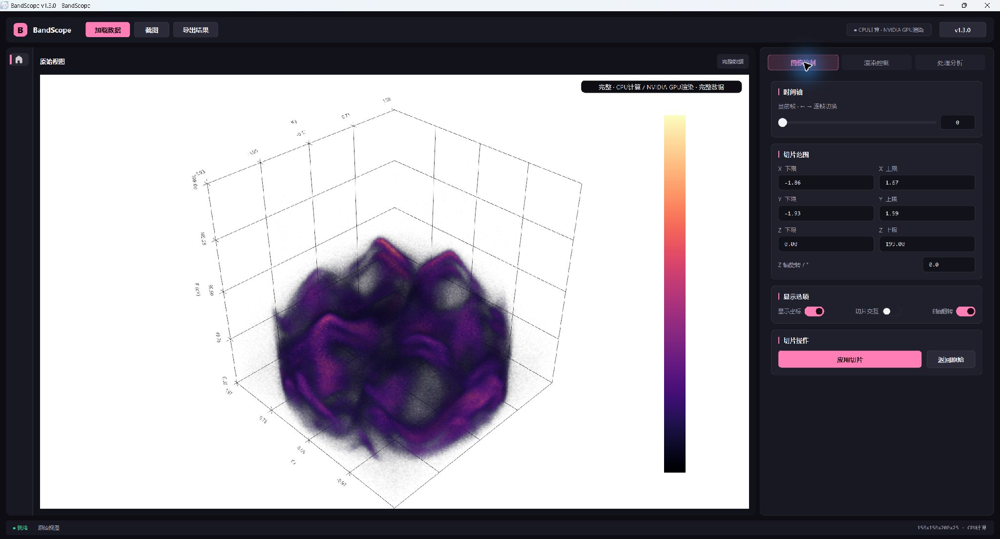
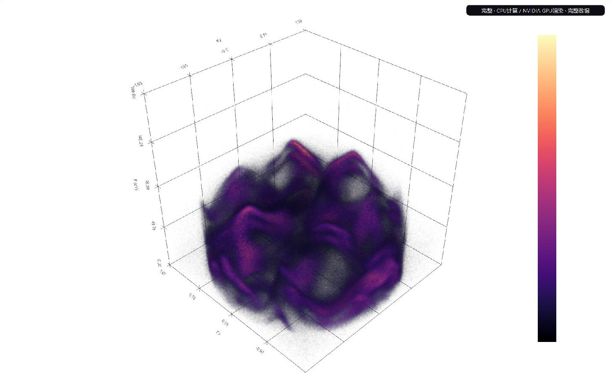
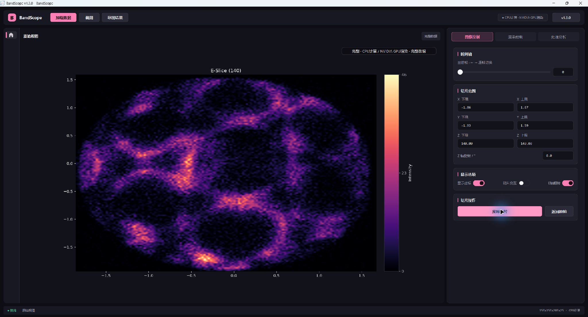
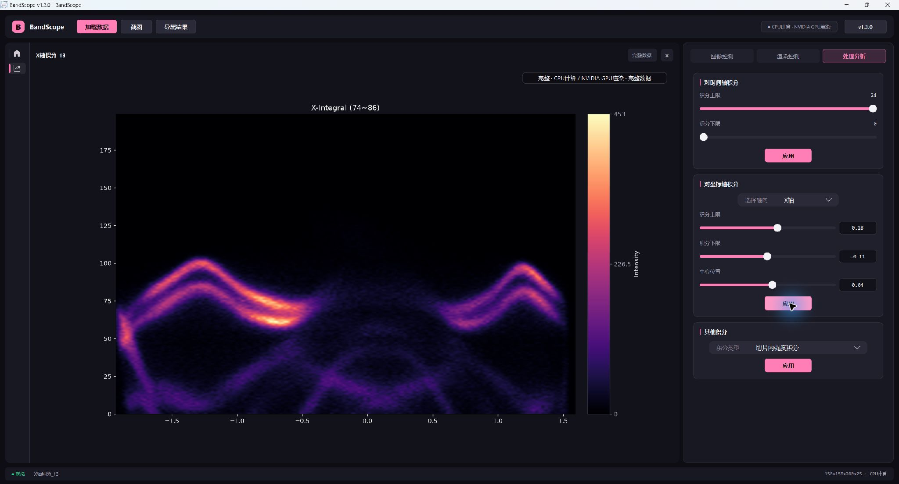
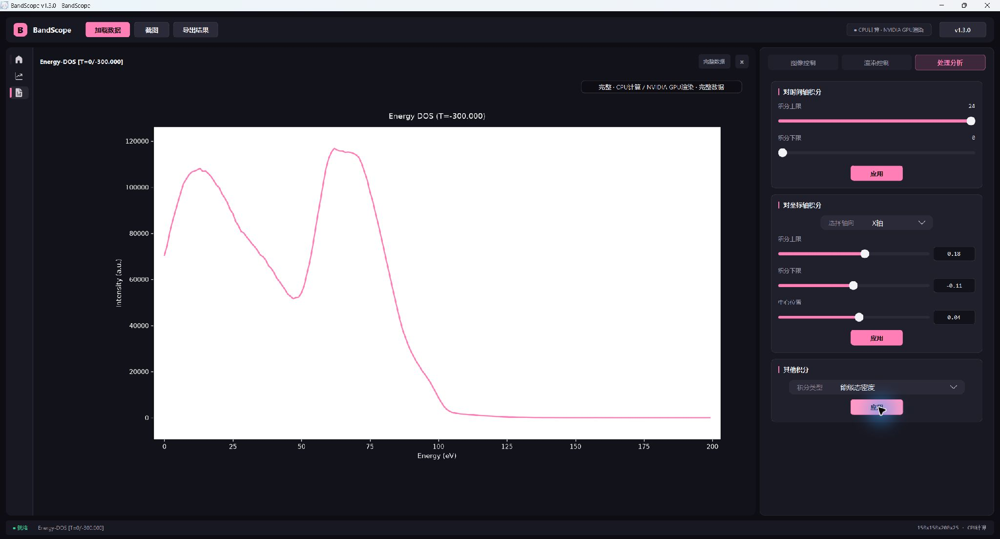

# BandScope

BandScope 是面向本地桌面实验环境的多维 ARPES 可视化与分析工作台，提供 `npz` / `mat` 数据加载、多数据源工作区、全局 ROI 数据域、3D 体渲染、2D 切片、折线路径 E–k 切片、交互裁剪、去噪、积分分析、DOS 分析、EDC 曲线、EDC 瀑布图、二阶导锐化、曲线比较、截图与结果导出、多页面 Blender 工程导出／回读与原位显示更新，以及可独立安装的官方扩展等能力。当前源码版本为 **v1.23.0**。

> 本项目 GUI 基于 [ChinaIceF/PyQt-SiliconUI](https://github.com/ChinaIceF/PyQt-SiliconUI) 开源项目修改而来。

---

## 界面概览

### v1.23.0 更新

本版新增能量两点定标：在轴分配窗口按 E1 零点与 E1–E2 目标间距重新生成均匀能量坐标，强度数据不变。Kx/Ky 与能量两个定标窗口统一为共享双端滑条并去掉长度输入框；EDC 与曲线比较页随本页时间区间重算；修正 2D 增强区域的预览刷新，底栏区间条不再显示长度输入框。

- **能量两点定标**：数据体卡片的「重新分配轴」窗口新增「能量定标」按钮，打开默认 XZ 切片（可切 YZ、可垂直翻转）的定标窗口；两条水平虚线表示 E1／E2，拖动图外手柄选层，输入目标间距与单位后应用。应用后 E1 为零点、E2 等于目标间距，按逻辑索引重新生成均匀且只读的能量坐标，强度数组不变；同一数据源的页面保留，页面能量区间、轴域与裁剪区域按新坐标重映射，保存入口沿用定标后完整数据体的 NPZ／MAT 导出。
- **定标窗口交互统一**：Kx/Ky 定标与能量定标共用双端滑条（黑白端点、中点整体拖动与合拢锁定徽章），不再显示长度输入框；两个窗口的 figure 只保留一个 axes 且不添加 colorbar。Kx/Ky 窗口的切片副标题注明取区间中心最近采样、不做积分。
- **EDC 与曲线比较按时间区间重算**：单选区 EDC、EDC 比较页（含基准曲线）与对数曲线页随本页时间区间重算，重算基于冻结的空间选区、旋转角与数据域；复制粘贴与跨文件的曲线保持冻结。出版导出中这些页按可重算区间标注时间信息，EDC／对数曲线导出附带当前帧与 `index_bounds`。
- **2D 增强区域预览刷新**：存在就绪或常量增强图层时，2D 预览改走完整渲染，避免 blit 后区域图层与主图错位；没有区域图层时 blit 预览不再排队多余重绘，显示统计只在精确渲染时等待。
- **底栏区间条与裁剪弹窗**：双端区间条不再显示长度输入框，仅保留程序化同步，轨道相应加宽；移除活动选区后裁剪弹窗自动关闭。

验证（Windows、仓库 `.venv`）：

- 全量 `python -m unittest discover -s tests -t .`：**2335 项通过**（2026-11-26，190.359 秒，单进程，日志 `.local/logs/release-1.23.0-full2.log`）；`compileall` 通过。
- `check_release_version.py v1.23.0`、`scripts/validation/verify_plugin_release_flow.py` 与 `git diff --check` 通过。
- 真实窗口（`.local/data/WSe2_step.npz`）：`verify_energy_calibration.py` 报 `[result] PASS`（入口、XZ／YZ 切换、垂直翻转、图外手柄拖动、应用后数值契约与关闭复核），截图与 `report.json` 在 `.local/outputs/energy-calibration/`；`verify_momentum_calibration.py` 报 `[result] PASS`（共享双端滑条、无长度输入框与色条、NPZ／MAT 保存回读的坐标键与单位契约）。
- 未执行：能量定标的 NPZ／MAT 保存回读与截图人工视觉复核；维护者人工视觉复核（定标手柄手感、区间条加宽后的布局、深浅主题）；冻结安装包与安装器的人工安装验收（以 CI 产物为准）。

### v1.22.6 更新

本版修正底栏双端区间条的整体平移交互：区间分离时改用中点下方的圆点整体拖动，轨道中段不再触发平移，端点命中改为按手柄实际外形判定；出版导出图的色标刻度文案由「Low/High」改为「Min/Max」。

- **区间条中点平移手柄**：区间分离时，轨道中点下方新增半径 4 px 的圆形手柄，以虚线短杆连接轨道；拖动圆点整体平移区间并保持长度，任一端触及轴边界时整段停下。轨道中段与选中线段不再响应整体平移，避免两端接近时误拖整段；合拢锁定后仍拖合并手柄连续浏览单层，此时不显示圆点，锁定浮标与开锁动画不变。
- **端点命中与指针**：端点与合拢手柄改为按胶囊外接矩形判定（端点左右各留 2 px，合拢手柄含 4 px 外扩描边），取代原来的水平 15 px 距离判定；悬停、按下与拖动共用同一套命中结果。鼠标默认显示箭头，仅在可拖动目标上显示手形；滑条提示「拖动黑白端点调整区间；拖动中点下方圆点整体平移」。圆点按主题取反色（浅色主题浅填充深描边、深色主题相反），悬停或拖动时描边加粗。
- **出版图色标刻度文案**：出版导出的色标刻度方式由「Low/High」改为「Min/Max」，下拉选项与出图标签一致；内部模式键仍为 `lowhigh`，旧配方与视图复现的读取行为不变。

验证（Windows、仓库 `.venv`）：

- 全量 `python -m unittest discover -s tests -t .`：**2106 项通过**（2026-11-23，222.161 秒，单进程，日志 `.local/logs/release-1.22.6-full.log`）；`compileall` 通过。
- `check_release_version.py v1.22.6`、`scripts/validation/verify_plugin_release_flow.py` 与 `git diff --check` 通过。
- 真实窗口（`.local/data/WSe2_step.npz`）：`verify_canvas_axis_slices.py` 10 项通过（新页端点、锁定与开锁动画、窄窗口两行、深浅主题与重复建页）；一次性真实窗口交互脚本 3 项通过（二维切片拖动圆点整体平移、轨道中段不触发平移、扫描轴多帧区间按帧整体平移）。
- 未执行：维护者人工视觉复核（圆点在深浅主题与窄栏下的观感、圆点与端点的命中手感）；冻结安装包与安装器的人工安装验收（以 CI 产物为准）。

### v1.22.5 更新

本版重做去噪管线：三级每级可从六种方法中任选一种或关闭，参数按方法分组可调。顶栏深浅主题按钮换成昼夜动画开关，不透明度插值选择换成图标动画开关，扫描轴滑块的停靠与整段平移设置移入「重新分配轴」窗口。

- **三级去噪管线与六种方法**：去噪仍按一、二、三级依次生效，每级新增「None」选项，可选 **高斯平滑**、**中值滤波**、**Savitzky-Golay滤波**、**小波去噪**、**非局部均值** 与 **低秩 SVD**，同一方法可在多级重复。高斯平滑按 Kx／Ky／E 分别设置标准差（采样点，`0` 关闭对应轴）；中值滤波按轴设置 1–31 的正奇数邻域（`1` 关闭）；小波去噪新增噪声标准差（`0` 为最细细节子带 MAD 自动估计）；非局部均值使用块大小、搜索距离、强度倍率与噪声标准差；低秩 SVD 对每个时间帧独立压缩 Kx×Ky 空间与能量构成的矩阵，秩上限为 `min(Kx×Ky, E)`。逐帧方法不跨时间帧混合信息，静态 3D 与 `[Kx, Ky, E, T]` 4D 数据均可使用；原「卡尔曼滤波」不再作为可选方法，旧文件中的该选择回退为 None。
- **参数校验与整次预检**：应用前按所有仍被页面引用的完整数据域或紧凑 ROI 预检方法与参数，任一数据域不兼容即整次拒绝并保留上一套结果。中值邻域上限 31、非局部均值块 15、搜索距离 20 与 SG 阶数 4 等限制在界面与直接计算 API 共用，不能绕过；SG 窗口按实际滑动轴长度校验；小波按各数据域的 `shape[:3]` 与所选基函数计算可用分解层数，超出上限或该 ROI 上限为 `0` 时报出请求值与可用上限并拒绝整次应用，不再静默降层；Bayes／SURE 阈值按细节子带计算。
- **旧算法名兼容**：旧复现文件中的「频域平滑」「滑动平均」「贝叶斯去噪」与历史乱码的 SG／小波名称分别识别为正名算法；修正后的小波与非局部均值不承诺与旧版逐值一致，也不保留旧数值分支。
- **昼夜动画开关**：顶栏原「深色／浅色」双按钮换成 96×38 自绘开关，浅色显示太阳与云层、深色显示月亮与星空，切换播放 560 ms 主题过渡，并含悬停回弹、焦点与禁用状态；鼠标、空格与外部主题变更共用原有主题入口，仍保存 `ui/theme`，不重建页面或请求数据重渲染。
- **不透明度插值动画开关**：「不透明度」标题行右侧的「平滑／直线」文字选择器换成 72×28 自绘滑块，左端为扭曲三角函数曲线、右端为三段折线图标，带纵深导槽与滑块切换动画；点击即切换并保持控制点原位与曲形，模式仍随显示样式保存与恢复。
- **扫描轴滑块设置移入轴分配窗口**：「滑块停靠」（自动／离散停靠／连续拖动）与「连续拖动时整段平移」（保持物理宽度／保持帧数）从数据源卡片菜单移入「重新分配轴」窗口，只影响扫描轴，不改变 Kx／Ky／E 轴的连续拖动。自动模式按采样点数选择：少于 30 点离散停靠、30 点及以上连续拖动，选项始终显示当前生效的模式。设置按数据源保存在本次会话，同源页面共用；「应用」后从下一次拖动生效，不改变当前选区，「取消」保留原设置。只改这两项不会重新应用轴分配或新建数据源；同时修改轴分配时随重设事务应用到目标源。离散模式下手柄吸附最近的采样坐标，整段移动按相同帧数平移；连续模式下可停在两个采样点之间，整段平移按「保持物理宽度」或「保持帧数」执行；整段拖到轴端时一起停止，升序、降序与不等间距坐标同样适用。

验证（Windows、仓库 `.venv`）：

- 全量 `python -m unittest discover -s tests -t .`：**2101 项通过**（2026-11-23，196.419 秒，单进程，日志 `.local/logs/release-1.22.5-full.log`）；`compileall` 通过。
- `check_release_version.py v1.22.5`、`scripts/validation/verify_plugin_release_flow.py` 与 `git diff --check` 通过。
- 真实窗口（`.local/data/WSe2_step.npz`）：`verify_axis_assignment.py` 20 项通过（含「重新分配轴」窗口内的扫描滑块停靠／整段平移检查）；`verify_independent_opacity_curve.py` 50 项通过（含插值动画开关，CUDA 实际执行）；`verify_fluent_icon_windows.py` 在单屏 DPR 1.25 下通过（主窗口、专注模式、出版导出、插件管理、Blender 标题与昼夜开关）。`verify_ui_themes.py` 深色主题的主窗口截图、背景与昼夜开关断言通过，随后仍在既有相机预设步骤失败（有效 3D 场景下切换视角预设后按钮未保持勾选，与本版改动无关），浅色主题流程因该失败未执行；本项不记为通过。未执行跨屏移动、真实 Blender 进程渲染与维护者人工视觉复核。

### v1.22.4 更新

本版为第四轴滑块加入停靠与平移设置，把三维不透明度曲线升级为可切换平滑／直线并支持垂直阶跃，并把 24 个 Fluent 按钮图标改为按实际物理像素绘制的可缩放图标。视图复现升到 schema 6、Blender 工程升到 schema 13（显示编辑格式 4），旧文件仍可打开。

- **第四轴滑块停靠与平移**：页面树上方数据源卡片新增「滑块」菜单，提供「滑块停靠」（自动／离散停靠／连续拖动）与「连续拖动时整段平移」（保持物理宽度／保持帧数）。自动模式按采样点数选择：少于 30 点离散停靠、30 点及以上连续拖动，菜单始终显示当前生效的模式。设置按数据源保存在本次会话，同源页面共用；修改不影响当前选区，从下一次拖动生效，单独改拖动设置不必重新应用轴分配。离散模式下手柄吸附最近的采样坐标，整段移动按相同帧数平移；连续模式下可停在两个采样点之间，整段平移按「保持物理宽度」或「保持帧数」执行；整段拖到轴端时一起停止，升序、降序与不等间距坐标同样适用。
- **不透明度曲线平滑、直线与垂直阶跃**：「不透明度」标题行右侧新增「平滑／直线」双段选择器，新曲线默认平滑。平滑采用保形三次插值（PCHIP），经过各控制点、保留平台且峰谷无过冲；直线沿用逐段线性。相邻点强度相同时形成垂直阶跃，精确命中该强度时取最后一个点的 α。移除固定最小间距、近邻合并与端点吸附，控制点可任意接近甚至重合，拖到邻点即停、反向拖动可重新拉开。沿平滑曲线加点会精确拆分原三次曲段并保留两侧切线，连续加点、平滑／直线往返与保存重开都保持原曲形；CPU、CUDA、编辑器绘制、出版导出与 Blender 体密度共用同一套曲段求值与阶跃规则。插值模式与曲段系数随显示样式、页面复制、视图复现与 Blender 编辑保存；视图复现升到 schema 6，Blender 工程升到 schema 13、显示编辑格式 4，旧点列、旧四参数与兼容映射曲线读取时明确还原为直线。
- **按钮图标高 DPI**：24 个 Fluent 按钮图标改为从现有 SVG 资源实时绘制的 `QIconEngine`，按目标物理像素绘制，100% 缩放下与旧版逐像素一致，125%、150%、175%、200% 按目标尺寸重绘。主窗口顶栏、画布工具条、页面树、数据源与工作区标题、出版导出、Blender 标题及宿主插件列表统一走公共图标入口，并按用途显式设置 14／15／16／18／20 逻辑尺寸；深浅主题、禁用／活动／勾选状态、专注模式切换与图标缺失回退保持原行为。数据源数据库、工作区页面类型与 Blender 标题三个装饰标签改为在重绘时绘制图标，跨屏移动跟随所在窗口的当前绘制设备。

验证（Windows、仓库 `.venv`）：

- 全量 `python -m unittest discover -s tests -t .`：**2012 项通过**（2026-11-22，165.319 秒，单进程，日志 `.local/logs/release-1.22.4-full.log`）；`compileall` 通过。
- `check_release_version.py v1.22.4`、`scripts/validation/verify_plugin_release_flow.py` 与 `git diff --check` 通过。
- 真实窗口与离屏校验（`.local/data/WSe2_step.npz`）：`verify_fluent_icon_dpi.py` 在 DPR 1、1.25、1.5、1.5625、1.75、2 下 24 个图标与禁用／勾选两状态全部通过；`verify_fluent_icon_windows.py` 在单屏 DPR 1.25 下通过（主窗口、专注模式、出版导出、插件管理与 Blender 标题）；`verify_independent_opacity_curve.py` 56 项通过（平滑曲线、垂直阶跃体图、模式往返与窄面板，CUDA 实际执行）。未执行双屏跨屏移动、真实 Blender 进程渲染与维护者人工视觉复核。

### v1.22.3 更新

本版把插件管理与更新设置收进「设置」窗口、把分析结果创建入口从页面树移到视图右键，并整理外观面板、底栏区间条与出版导出窗口里的重复标题和提示。v1.22.2 标签的 CI 在聚合插件目录时失败——`edc_waterfall` 1.0.1 的入口说明改动没有升版本，历史目录拒绝同一版本换内容——未产出 Release；本版把该插件升至 1.0.2，功能与 v1.22.2 相同。

- **设置内嵌插件管理与更新设置**：「设置 → 应用管理」下的「插件管理」「更新设置」改为左侧二级内嵌页，选中即显示；原「打开…」按钮与独立功能窗口删除，重复进入仍复用同一设置窗口。插件管理保留「已安装」「官方插件」「插件设置」三页签及安装、启用／停用、卸载、重试加载与恢复上一版本。更新设置「保存」后留在当前页，「取消」恢复已保存值，「检查更新」先保存当前设置再启动手动检查，主设置窗口不关闭。检查或下载期间两个页面的编辑控件被禁用；更新页处于活动状态时暂停后台自动检查，用户仍可手动检查。关闭或隐藏设置窗口会协作式取消目录获取与插件下载线程并清理临时下载目录，再次打开仍复用同一面板。
- **视图右键「处理分析」**：切片内强度积分、能级态密度、EDC 瀑布图、单条 EDC 曲线、二阶导与 API 3 插件动作，从页面树右键「创建结果页」移到当前页 2D／3D 视图右键的「处理分析」子菜单；裁剪／裁空模式的紧凑右键菜单同样提供该入口。菜单只对当前活动页过滤合法动作，打开菜单不切页，点击后才激活并再次校验；页面树与「我的分组」副本右键只保留改名、复制、删除等页面操作，`Ctrl + 2` 仍不切换控件页。
- **外观面板整理**：色阶与不透明度上方新增「显示对象」行（原「区域」下拉与锁定按钮），两者共用该调整对象；分组标题改为「色阶」「不透明度」「去噪」，去噪组标注「当前数据范围 · 全局共享」，色带选择行说明全部显示对象共用同一输出色带，锁定按钮提示改为「锁定全部强度范围」。移除色阶与不透明度控件里的中轴分割线。
- **视角卡片精简**：「相机视角」更名为「视角」，移除卡片内与画布工具条重复的「重置视角」按钮，恢复默认视角统一用画布右侧工具条。
- **底栏与区间条**：位置／时间区间条去掉「合拢逐帧 · 分离积分」「沿 X 积分」等副标题与「区间长度」标签，单行高度 64→74、两行 40→60；锁定浮标缩小，合拢锁定后整体平移时坐标浮框跟随手柄移动。
- **出版导出窗口精简**：移除窗口顶部重复的图标标题、当前视图族徽标、来源说明与「冻结快照」提示，以及「主视图坐标轴开关已关闭」提示和每 600 毫秒轮询来源是否过期的逻辑；垂直空间留给预览与参数区。
- **后台线程收尾**：插件管理的官方目录获取与插件下载线程改由模块级强引用持有，`finished` 后释放；关闭面板只做协作式取消和有界等待，晚到结果按发送者身份丢弃。更新检查与下载线程同样按发送者收尾，旧线程结束不会清空当前线程引用或覆盖新状态。
- **EDC 瀑布图插件 1.0.2**：代码不变，仅同步视图右键「处理分析」入口的说明；`flat_band_opacity` 仍为 1.2.3。

验证（Windows、仓库 `.venv`）：

- 全量 `python -m unittest discover -s tests -t .`：**1964 项通过**（2026-11-22，159.199 秒，单进程，日志 `.local/logs/release-1.22.3-full.log`）；`compileall` 通过。
- `check_release_version.py v1.22.3`、`scripts/validation/verify_plugin_release_flow.py` 与 `git diff --check` 通过。
- 真实窗口（`.local/data/WSe2_step.npz` 与合成动态数据）：`verify_integration_context_menu.py` 在视图右键创建链路、深层主题与非法页过滤上通过；`verify_plugin_management.py` 在内嵌三页签、更新设置保存／取消／检查与窄窗滚动上通过。未做人工视觉逐张复核。

### v1.22.1 更新

本版是 v1.22.0 的发布修正，功能与 v1.22.0 相同（详见下一节）。v1.22.0 的 CI 全量回归在 `tests.integration.test_axis_interval_pages` 处中断，未产出 Release。

- **积分区间控制器**：底栏区间条的输入框与滑条在底栏销毁后 C++ 对象已不存在，控制器仍持有其 PyQt 包装；迟到的 `editingFinished` 会在同步中访问已销毁控件并抛 `RuntimeError`，该异常从 Qt 槽冒出会终止进程。现在所有控件访问先判断 `sip.isdeleted`，销毁后一律跳过；`attach()` 重新装配前先断开旧控件。
- **测试清理**：区间页面集成测试改为每个测试结束显式拆除无父控件的底栏，避免循环 GC 在别的测试绘制中途销毁控件；另补两项控制器单元测试。

验证（Windows、仓库 `.venv`）：

- 全量 `python -m unittest discover -s tests -t .`：**1941 项通过**（2026-11-21，155.846 秒），日志 `.local/logs/release-1.22.1-full.log`；`compileall` 通过。
- `tests.integration.test_axis_interval_pages` 修正后连续 15 次单独运行全部通过；`tests.ui.test_axis_interval_controller` 24 项通过。
- 真实窗口（`.local/data/WSe2_step.npz`，修正后重跑）：`verify_axis_assignment.py` 18 项、`verify_canvas_rotation_dial.py` 13 项通过；色阶、不透明度曲线、路径切片、画布轴切片与派生瀑布图脚本亦在同一数据上通过。
- `check_release_version.py v1.22.1`、`scripts/validation/verify_plugin_release_flow.py` 与 `git diff --check` 通过。

### v1.22.0 更新

本版重做数据轴分配与画布交互：加载后自动分配 Kx／Ky／E／扫描轴并可在数据源卡片重设；扫描轴支持时间、角度、温度与自定义。画布视图控件移到右上角悬浮工具栏，Z 轴旋转改为旋钮弹层，底栏改为位置与时间两组双端区间，并新增折线路径 E–k 切片与画布轴切片。外观控制改为累计直方图输入色阶、可编辑不透明度曲线与「输出色带」菜单，计算后端、渲染质量与去噪参数收进分级设置窗口。视图复现文件与 Blender 工程格式同步升级，旧文件仍可打开。

- **自动轴分配与数据源卡片**：加载 NPZ／MAT 后先自动分配 `Kx / Ky / E / 扫描轴` 并直接打开工作区，左栏「搜索页面」下方的数据源卡片显示当前分配与「待确认」状态（例如「Kx、Ky 等长，按文件顺序分配」）；无法识别第四轴时显示「扫描轴（索引）」按帧号浏览。点击整张卡片或用键盘激活可打开「重新分配轴」窗口，即使当前在裁剪页也显示原始数组的维度与长度；每个槽位可选原始维度及等长的文件坐标或索引，扫描轴另可选类型、名称与单位，窗口预览坐标首末值并支持恢复自动分配，提交前校验维度唯一、坐标有效且长度匹配。MAT 与 NPZ 共用同一套规则，转换时保留长度匹配的坐标候选、原键名与单位（含行／列向量）。
- **扫描轴（时间／角度／温度）**：底条扫描区间控件、←／→ 快捷键、区间求和、「切片内强度积分」、图题与轴标签、出版图、数值导出及插件可选 `scan_axis` 统一使用实际轴名与单位，例如温度扫描可逐点查看、对所选温区求和，并生成横轴为「温度 / K」的强度曲线；时间数据保留缺省 `fs` 与旧导出字段，角度和温度缺单位时只显示名称。只有原始主页时在当前源应用重设；已有裁剪、ROI 或派生页时以「作为新数据源打开」，取消或应用失败保留原工作区。手工分配随当前源与普通／Blender 配套复现文件保存，同一文件两种分配互不串源，直接重开原始文件会重新自动识别。重排使用原始强度数组的转置视图，不复制整块数据体。
- **画布悬浮工具栏与 Z 轴旋钮**：「显示坐标」「图像翻转」「Z 轴旋转」从底栏移到画布右上角悬浮工具栏，前两项改为图标开关并在开启时高亮。Z 轴旋转改为按需展开的原生旋钮弹层：拖动外圈从当前角度连续旋转（跨过顶部保持连续，到 ±360° 停止），中央可直接输入两位小数的带符号角度，上下键按 `1°` 步进，回车或结束编辑提交，「归零」立即回到 0° 且不改变相机位置与朝向；再次点击 Z、点面板外或按 Esc 收起。拖动期间只预览，松手提交一次精确刷新。底栏宽度因此全部留给位置与时间滑条；窗口高度不足时视角预设组自动收起，右侧面板标题区重复的「重置视角」按钮移除。
- **坐标轴切片与位置区间条**：3D 画布右上角的 XY／XZ／YZ 从视角预设改为切片入口，分别沿 E／Y／X 轴积分，并在来源页下新建独立结果页，同一方向可保留多个区间比较；新页默认只显示有效法向范围的 25%–75%，右上角出现 3D 按钮返回来源页。原「对坐标轴积分」卡片的选轴、上下限与「应用」按钮移除，位置与厚度改由底栏双端区间条控制：黑白两枚胶囊手柄拖到接触即停并自动锁定，重合时显示白壳黑芯与锁浮标，点浮标播放开锁动画后再向两侧拖开；拖中段整体平移，悬停端点出现可编辑坐标浮框（回车或失焦提交、Esc 撤销），右侧长度框按「上限 − 下限」输入并以中心扩缩。每个切片页保存自己的端点与锁定状态。
- **时间区间并入底栏**：时间轴改为同一套双端区间控件，两端合拢时逐帧，分离后对当前视图做时间积分；拖动合并手柄或按 ←／→、Shift+←／→ 逐帧，解锁后两端可分别展开，长度框输入 0 恢复单帧。原来「先在处理分析页设积分再生成独立结果页」的流程取消，积分直接作用于当前视图；3D、2D、EDC、能级态密度、二阶导、路径切片与可重算的插件派生页都可直接调整，完整时间曲线与纯曲线快照页不显示该控件，每页独立保存区间。底条只排布位置与时间两组：同时显示时等分宽度、空间不足换两行、只有一组时占满、都隐藏时折叠；同时修正时间轴选区在部分主题下被画成黑色的问题。
- **折线路径 E–k 切片**：在 kx–ky 等能面或 E 积分动量图上点亮画布右上角的折线工具后，左键依次落点连线，双击节点原位改名，右键可生成路径切片、撤销上一点、清除选点或退出；至少两个位置不同的相邻点才能建页，生成后自动进入来源页下的 E–k 子页。横轴是沿折线累计的动量距离，纵轴沿用来源体有效能量范围；按各段实际动量长度采样并做双线性插值，支持闭合路径、非均匀／倒序坐标、裁剪、旋转、去噪、时间切帧与增厚平均（厚度为沿段法线对称展开的总宽度，0 表示中心线）。底部选段条按真实段长绘制整条路径，普通点击单选、Shift 点击跳选；厚度与黑灰白场、强度映射只写入选中的段，多选时回显共同值或「多值」并只写入改动字段；长路径可用水平滑条平移 k 视口，底条保留整条路径概览。数值导出、出版图、页面复制、数据源切换与复现都保留完整路径与分段参数。
- **右键「创建结果页」**：右侧不再有独立的「处理分析」页，直接显示外观控制，原下拉入口与 `Ctrl + 2` 一并移除。切片内强度积分、能级态密度、EDC 瀑布图、单条 EDC 曲线、二阶导与 API 3 插件结果改为在来源树或「我的分组」的页面副本上右键「创建结果页」：菜单按父页页型、时间轴、已保存裁剪参数与插件就绪状态动态过滤，只显示合法动作，打开菜单不切页，点击后才激活父页并再次校验。新复现文件不再保存旧的类型下拉选择，读取旧文件时忽略该选择。（2026-11-21 起入口已改为视图右键「处理分析」，页面树入口移除；见下文当前说明。）
- **输入色阶与输出色带**：「色阶调整」改为上下两组。上组是「输入色阶 · 累计直方图」加黑、灰、白三枚胶囊手柄（与时间轴区间滑块共用 10×16 样式），直方图柱高表示强度不低于该阈值的累计点数，悬停显示阈值和点数；黑白点设定输入强度上下限，灰点决定映射到色带中点的强度（向左提亮、向右压暗），拖黑白点时保留当前 Gamma，三枚手柄始终有序并支持方向键微调。下组「输出色带」横向铺满当前色带，下方两枚小房屋标记选择原色带的输出子区间（默认 0%–100%），选区外淡遮罩并显示百分比；截断只改颜色，不改变透明度的强度坐标。统计对象跟随当前帧与调整目标（三维统计有效体素、二维统计当前切片、局部区域、全部显示），使用上色前强度并排除 NaN／无穷；二维图、三维体、屏幕色标、出版与 Blender 导出共用同一截断结果。
- **「输出色带」菜单**：删除原来的「色带选择」卡片及其「确定」按钮，色阶卡片内的「输出色带」标题行成为主界面唯一的色带入口：右侧显示当前色带名与下拉箭头，点击展开带完整渐变色样、名称与当前项勾选的可滚动单列菜单；列表以 `magma`、`coolwarm` 开头，其余保持原有相对顺序，`coolwarm` 只出现一次，默认 `magma`。选中另一条色带后菜单收起、渐变条立即更新、当前视图只精确刷新一次；悬停、取消或再次选择当前项都不触发渲染。换色带保留当前输出区间（例如 `magma` 的 15%–80% 切到 `coolwarm` 后仍停在 15% 和 80%），缺少色带值的旧状态回落到 `magma`，Blender 导出窗口复用同一份列表。
- **三维不透明度曲线直接编辑**：删除「强度归一化」「显示模式」「强度映射方式」及「独立不透明度」的黑场、过渡宽度、Gamma、整体密度四个输入框，三维不透明度改为一根可直接编辑的曲线，新页面默认三点 `(0%, 0) / (50%, 0.5) / (100%, 1)`，默认色阶下与旧「兼容映射 → 线性」逐体素一致。底轨圆点水平定位强度，向上拖时黑点脱离轮廓、沿竖直虚线随光标上移，碰到曲线即插入并选中新点，原位轮廓约 200 毫秒回填；碰线前松手不生成点，拖回底轨可继续水平拖动。曲线上的点同时调整强度与 α（横向限制在相邻点之间），两个端点固定在 0%／100% 强度并可上下调整，内部点可拖到 α＝0 并保留；右键「删除控制点」或焦点在曲线上时按 `Delete` 删除内部点，端点始终保留。强度范围统一为完整范围，颜色与透明度独立计算；CPU、CUDA、出版导出与 Blender 体密度换算共用同一条曲线与参考距离，Blender 工程编辑窗口复用该控件。二维与路径切片页面只显示适用的颜色控件，新建路径段默认线性，旧分段映射仍按保存值还原。
- **分级设置窗口**：右上角齿轮从菜单改为非模态「设置」窗口，左侧按「计算与显示」「数据处理」「应用管理」分级，重复点击复用同一窗口。计算后端（Auto／CPU／NVIDIA GPU，GPU 不可用时禁用并说明原因）与 3D 渲染质量（质量模式、体插值、静止质量）移入「计算与显示」，即时作用于当前 3D 视图并记住，跨数据源与重启共用；渲染质量改为全局本机设置，不再随页面或复现文件变化。去噪参数内嵌到「数据处理 → 去噪参数」，不再弹独立小窗。当前源码中，插件管理与更新设置也是「设置 → 应用管理」左侧的二级内嵌页，选中即显示，不再有「打开…」按钮或独立功能窗口；插件管理的「已安装」「官方插件」「插件设置」三页签及安装、启用／停用、卸载和设置操作不变。更新设置的「保存」留在当前页，「取消」恢复已保存值，「检查更新」先保存再启动检查且不关闭主设置窗口；检查或下载期间禁止编辑。MatElab 登录等必要弹窗仍保留。原齿轮菜单的三个入口不再存在。
- **复现文件与 Blender 工程格式**：视图复现升到 schema 5，不透明度保存为按强度排序的归一化 `(强度, α)` 点列并保存输出色带区间；读取 schema 1–4 时先按原格式校验原始摘要再迁移，旧四参数／兼容曲线按原公式转换并自适应补点（参考距离下 α 误差不超过 `1/255`），旧百分位／手动强度范围转为完整范围，旧锁定按恢复帧重建，旧时间积分页恢复为当前视图的时间积分状态。Blender 工程升到 schema 12、显示编辑格式 3，编辑窗口直接编辑同一条曲线；schema 7–11 工程仍可打开并原位更新（7–9 保留原预设，10–11 继续以四参数与格式 2 更新，需要自由控制点时重新导出），Blender 配套复现升到 schema 2（内嵌视图配方 schema 5），schema 1 仍可读取。
- **其他**：出版图与 Blender 导出对均匀网格的判定放宽到 `float32` 坐标舍入——步长差异只来自低精度坐标舍入时不再误报「非均匀网格」，原坐标与强度不被重采样，真正非均匀的轴仍给出明确提示。EDC 瀑布图插件升至 1.0.1，代码不变、仅同步新宿主「右键 → 创建结果页」入口的说明（旧宿主仍在「其他积分」下拉提供同一动作）；`flat_band_opacity` 仍为 1.2.3。

验证（Windows、仓库 `.venv`）：

- 全量 `python -m unittest discover -s tests -t .`：**1939 项通过**（2026-11-21，分段执行；除 `tests.integration.test_axis_interval_pages` 外的 158 个模块 1906 项一次通过、169.4 秒，日志 `.local/logs/release-1.22.0-chunked-main.log`；该模块 33 项在第 4 次运行通过，前 3 次为该模块既有 Windows 原生中断 0xC0000409，日志 `.local/logs/release-1.22.0-axis-interval-pages-attempt4.log`）。单进程全量仍会在同一模块触发既有 0xC0000005 原生崩溃，日志 `.local/logs/release-1.22.0-full.log`。`compileall` 通过。
- 真实窗口（`.local/data/WSe2_step.npz`）：`verify_axis_assignment.py` 18 项通过（WSe₂ 时间扫描兼容、卡片重设、降序温度扫描、曲线与数值／出版导出）；`verify_canvas_rotation_dial.py` 13 项通过（原生旋钮弹层、负小数、跨零单次提交、归零、宽窗／窄窗／低高度布局与路径选段条）；`verify_levels_and_colormap_range.py`、`verify_independent_opacity_curve.py`、`verify_path_slice.py`、`verify_canvas_axis_slices.py` 与 `verify_derived_waterfall.py` 亦在同一数据上通过，报告与截图在 `.local/outputs/` 下。
- `check_release_version.py v1.22.0`、`scripts/validation/verify_plugin_release_flow.py` 与 `git diff --check` 通过。

未执行：维护者人工视觉复核（不透明度曲线与底轨加点手感、色带菜单滚动手感、窄侧栏与深浅主题观感、Z 轴旋钮弹层在原生画布上的拖动、双端区间条与路径选段条的开锁动画、设置窗口导航）；真实 Blender 进程渲染对照（本轮只核对工程元数据、体密度换算与合成工程回读）；冻结安装包与安装器的人工安装验收（以 CI 产物为准）。

### v1.21.2 更新

本版修正大数据加载与 GPU 体渲染：超大 MATLAB v5 数值矩阵改走只读内存映射，加载与转换不再为转连续内存额外复制整块数组；带 NaN 掩膜的体渲染在显式质量设置下改为在体属性上设置插值，不再调用 GPU 光线投射映射器没有的接口。

- **超大 MAT v5 导入**：MATLAB v5 用 32 位长度字段记录数据字节数，单个数值矩阵超过 4 GiB 时长度回绕，`scipy.io.loadmat` 读取失败。现在识别这种文件后按列主序（`order="F"`）只读内存映射打开，仅支持单个、未压缩、非复数的数值矩阵且数据位于文件末尾；其他 MAT 文件仍走原读取路径，行为不变，转换失败时仍会清理未完成的输出文件。
- **加载与转换的内存占用**：NPZ 加载去掉强制 `ascontiguousarray`，保留原数组布局，不再生成整块连续副本；MAT 转换中的 float32 样本不再复制。大数组的峰值内存相应降低，显示与导出结果不变。
- **GPU 体渲染插值**：含 NaN 掩膜的体数据必须使用 `vtkGPUVolumeRayCastMapper`，该映射器没有 `SetInterpolationMode`；显式质量设置改为在体属性（`GetProperty().SetInterpolationType`）上设置线性／最近邻插值，并跳过不存在的交互采样接口，掩膜体不再因设置插值失败；自动调整、采样距离与静止／预览切换仍按所选质量生效。

验证（Windows、仓库 `.venv`）：

- 全量 `python -m unittest discover -s tests -t .`：**1733 项通过**（2026-11-19，218.939 秒），日志 `.local/logs/release-1.21.2-full.log`；`compileall` 通过。
- `check_release_version.py v1.21.2`、`scripts/validation/verify_plugin_release_flow.py` 与 `git diff --check` 通过。

未执行：维护者人工视觉复核（真实超大 MAT 文件的导入耗时与内存占用、GPU 掩膜体在不同显卡上的插值观感）；冻结安装包与安装器的人工安装验收（以 CI 产物为准）。

### v1.21.1 更新

本版是 v1.21.0 界面重做的修正版：把更新、插件与去噪入口集中到顶部齿轮菜单，画布工具条改为右上角竖排，色带锁定按钮改为动画图标开关，并修复浅色主题下下拉框文字、画布坐标与色条配色在切换主题后不刷新或出现黑角的问题。

- **齿轮设置菜单**：顶部工具栏新增齿轮按钮，集中「更新设置…」「插件管理…」「去噪参数设置…」三个入口；移除原「扩展」按钮与右侧版本按钮，版本号移到状态栏。画布右键菜单不再重复这些入口。插件管理入口在扩展模块不可用时保持禁用并说明原因。
- **更新设置与检查**：更新设置窗口显示当前版本，并新增「检查更新」按钮；点击后先保存窗口里的更新源与账号、关闭窗口，再启动手动检查。「保存」「取消」语义不变，检查或下载期间仍不能修改设置。
- **新版本提示**：更新说明与插件影响收进「详细信息」，默认折叠，长说明不再把确认弹窗撑高；需要时展开查看。
- **画布工具条**：工具条从画布左上角横排改为右上角竖排，3D 视角预设按画布高度自动收起；圆角改用原生窗口遮罩绘制，VTK 画布透出时不再出现直角黑边。
- **色带锁定开关**：渲染控制里的锁定按钮改为只显示图标的动画开关，切换时锁钩在 180 ms 内开合；主题切换与状态恢复都保持图标一致，不再改写按钮文字。
- **主题切换修正**：应用样式改用 `palette(...)` 角色，切换主题时不再整表重设应用样式与调色板；浅色主题下可编辑下拉框、弹出列表和新建菜单项的文字保持黑色，深色主题跟随窗口文字色。2D 画布的标题、坐标轴、刻度、图例、色条与裁剪选择框随主题刷新，3D 标量条文字与坐标轴一并更新；切换主题不重新渲染数据，不改变当前参数与相机。
- **其他**：勾选图标统一为 `assets/ui/check.svg`；主窗口事件过滤器只处理按键、鼠标、进入 / 离开、失焦与右键事件，减少无关事件进入裁剪与增强逻辑。

验证（Windows、仓库 `.venv`）：

- 全量 `python -m unittest discover -s tests -t .`：**1728 项通过**（2026-11-17，218.983 秒），日志 `.local/logs/release-1.21.1-full.log`；`compileall` 通过。
- 真实窗口 `scripts/validation/verify_ui_themes.py`：**PASS（0）**，报告与截图在 `.local/outputs/ui-themes-1.21.1/`；`verify_plugin_management.py` 全部通过；`verify_color_lock.py` 的 3D／2D 锁定与解锁检查全部通过。
- `check_release_version.py v1.21.1`、`scripts/validation/verify_plugin_release_flow.py` 与 `git diff --check` 通过。

### v1.21.0 更新

本版重做桌面界面：新增深色／浅色双主题（新环境默认浅色），把工具栏、参数面板、页面树、结果页标题、状态栏与各次级窗口统一为中性黑白灰样式；画布顶部新增视角预设与常用操作工具条，数值输入框支持按光标所在数位滚轮微调，2D／3D 画布背景与坐标轴配色跟随主题；多视图 Blender 工程的辅助预设改为只生成一组。

- **深色／浅色主题**：顶部工具栏新增「深色／浅色」分段按钮，新环境默认浅色。切换时重着色已创建控件：改写控件 QSS 中的颜色令牌、刷新 SiUI 色板与 Qt 调色板、重取图标颜色、更新 2D／3D 画布背景；出版导出、扩展管理、Blender 工程、更新设置与弹层等次级窗口一并跟随。当前页面的数据、参数与相机保持不变，选择写入本机设置（`ui/theme`）供下次启动恢复。界面强调色随主题取深灰或浅灰，删除等不可逆操作仍用语义色。
- **主窗口与面板布局**：顶部工具栏、右侧检查器、结果页标题与状态栏重新排布并收紧间距；结果页标题显示数据源面包屑、页面标题、视图类型标签（3D VOLUME／2D MAP／1D CURVE）与数据域标签；页面树新增「工作区／PAGES」标题与数据源摘要卡片（别名、文件名、形状与计算后端），仅有一个数据源时在工具栏显示数据源徽标。参数分组改为可折叠的扁平分组，标题可点击展开／收起，滚动区在折叠后重新计算高度；控件宽度、按钮与下拉框尺寸同步收紧。
- **画布工具条**：画布顶部新增悬浮工具条，集中提供 3D／XY／XZ／YZ 视角预设、重置视角、裁剪、裁空、导出结果与「专注画布」；视角预设按钮随实际相机姿态回读切换，专注模式隐藏分析与页面侧栏，再次点击恢复。
- **数值输入滚轮**：新增应用级滚轮过滤器。光标停在数值框的某个数位上时，滚轮按该位步进（整数、小数与科学计数法均适用），执行后光标停留在同一数位；滑块与数值输入的双向同步、裁剪弹层与插件面板中的数值框保持一致。
- **画布与曲线配色**：2D 预览的背景、坐标轴、刻度与标题颜色改为跟随主题，3D 背景使用主题画布色，并在加载数据与切换主题后恢复，不再固定黑底；屏幕坐标轴与曲线身份色改用与主题一致的中性色板，出版图仍使用独立的白底曲线身份色，本版未改变出版配色。
- **次级窗口**：出版导出窗口改为左侧预览、右侧可滚动选项的双栏布局，标题改为「出版级导出」，样式卡片缩小并保留原有选项；扩展管理、Blender 工程窗口增加图标标题与说明文字，标签页、表格与按钮风格统一；勾选框图标按主题提供 `assets/ui/check-light.svg` 与 `check-dark.svg`。
- **Blender 多视图共享预设**：多页面工程只在首个视图生成一组五类辅助预设（坐标轴及文字、辅助盒框、方向标、薄层长方体、文本预设），其余视图只创建数据体、备用相机和自身需要的数据体灯；`project.layout.preset_owner` 记录持有者，组间距按首组实际边界计算，后续纯数据视图沿 +X 依次排列且不与共享预设重叠。旧工程仍按原配置回读和原位更新，缺少 `preset_owner` 时回退到首个条目；导出面板的预设分组标题改为「工程级共享预设（多视图仅生成一组）」。
- **兼容与打包**：未修改数据格式、视图复现文件格式、插件 API 与运行依赖；Blender 工程 schema 仍为 11（新增 `layout.preset_owner`，旧工程回退首条目）；PyInstaller 打包新增 `assets/ui` 资源，旧兼容导入（`theme`、`ui_controls`、`plugin_api`）仍指向新模块。

验证（Windows、仓库 `.venv`）：

- 全量 `python -m unittest discover -s tests -t .`：**1703 项通过**（2026-11-16，555.205 秒），日志 `.local/logs/release-1.21.0-full.log`；`compileall` 通过。
- 真实窗口 `scripts/validation/verify_ui_themes.py`：深浅主题切换、参数保持、相机预设与主窗口／出版／扩展／Blender／更新设置的实际控件状态检查 **PASS（0）**；截图与报告在 `.local/outputs/ui-themes-1.21.0/`。脚本用屏幕抓取生成截图，本次运行时桌面上另有打开的 BandScope 窗口，截图会混入其他窗口内容，仅作参考，视觉观感仍需人工复核。
- `check_release_version.py v1.21.0`、`scripts/validation/verify_plugin_release_flow.py` 与 `git diff --check` 通过。

未执行：维护者人工视觉复核（深浅主题的对比度与观感、折叠分组与窄栏布局、画布工具条与专注模式、滚轮微调手感、各次级窗口的实际观感）；真实 Blender 下多视图共享预设的重开、总览与 Append 观感；冻结安装包与安装器的人工安装验收（以 CI 产物为准）。

### v1.20.0 更新

- **体渲染独立透明度与强度归一化**：右侧「渲染控制」新增「显示模式」（独立透明度／兼容映射）、「强度归一化」（完整范围／百分位 P0–P99.5／手动范围，并显示实际强度范围）与「独立透明度」卡片（阈值、起始过渡宽度、透明度 Gamma、整体密度，滑条与数值输入双向同步）。颜色与透明度各自独立计算：黑场、白场与颜色 Gamma 只改颜色，阈值以下体素完全透明，弱信号不再带一层底雾。新页面默认独立透明度与百分位归一化，旧页面、旧复现文件和旧 Blender 工程保持兼容映射；样式随页面复制、派生与跨源恢复，并写入复现文件、出版图和 Blender 导出。
- **渲染质量**：新增「渲染质量」卡片，可切换明确采样／兼容质量、线性或最近邻体插值、静止标准（0.5 × 最小间距）或精细（0.25 × 最小间距）；交互拖动时按 2 × 最小间距预览，停止后恢复所选静止质量，原生 interactor 的刷新率设置不再被静默忽略。
- **Blender 数据体外观**：导出窗口新增「数据体外观」下拉框。自发光（默认）保持原外观；柔和受光以散射为主并保留少量自发光，按条目自动创建主光、补光与轮廓光三盏 Area 灯，用 Cycles 灯光链接只照射该条目数据体，散射与吸收之和保持原总消光。两种外观共用同一份强度、颜色、alpha 与密度数组，模式在提交时冻结、任务期间禁用，不跨重启记忆。
- **十种文本预设**：预设增至五项，新增「文本预设」，一次生成十个可编辑 Text 对象（统一大写 `A`、0.12 Blender 单位字高、两行五列），包含平面、立体、空心描边、发光、金属与玻璃样式；DejaVu 字体及许可证写入 `fonts/` 并打包进 `.blend`，每个文本有独立的文字曲线、材质和只照文本的辅助灯。
- **Blender 配套复现文件**：导出面板新增默认勾选的「同时保存复现文件」，额外生成 `名称.blend.bsview.json`，保存逐页科学配方、显示与质量、来源会话分组、条目顺序和全部导出设置。可通过「加载数据」单独打开：按原来源会话逐组主动选择 NPZ，全部来源校验和预计算成功后才整体新增工作区；工程、资产与配置统一暂存和提交，失败或取消整体回滚，覆盖旧工程时提示旧配置也会移除。
- **格式与兼容**：新 Blender 工程为 schema 11、显示编辑格式 2，视图复现文件为 schema 3；schema 7–10 工程仍可打开并原位更新，保持原版本、原预设与自发光外观，不补柔和受光灯组，需要新外观时重新导出。

验证（Windows、仓库 `.venv`）：

- 全量 `python -m unittest discover -s tests -t .`：**1669 项通过**（2026-11-13，118.812 秒），日志 `.local/logs/release-1.20.0-full.log`；`compileall` 通过。
- Blender：真实 Blender 5.2.3 LTS 下柔和受光验收 7 项、八材质回归 15 项、多页往返 5 项均通过；配套复现配置真实窗口验收 29 项通过（同源两页、配置单独恢复、显示覆写原位更新、`.blend` 摘要不变、同组仅一次选源）；两种外观分别完成 WSe₂ 导出与重开渲染。
- 显示质量：WSe₂ 真实数据动态帧约 128 ms、局部增强约 129 ms（窗口内耗时，非独立基准）；CPU／NVIDIA 开发冻结包已分别验证启动、显示与导出。
- `check_release_version.py v1.20.0`、`scripts/validation/verify_plugin_release_flow.py` 与 `git diff --check` 通过。

未执行：维护者人工视觉复核（灰白合成体在柔和受光下的高光截断、内部连续性、遮蔽、偏色与弱带去噪，十种文本和八种薄板的观感）；原生文件对话框、主动选源与覆盖确认的人工交互；冻结安装包与安装器的人工安装验收（以 CI 产物为准）。打包配置已收集 `bandscope/exporting/blender_script.py` 资源与 Matplotlib 字体数据，本版未调整运行依赖与插件加载路径。

### v1.19.0 更新

- **Blender 工程导出**：顶部新增独立的「导出 Blender 工程」入口（与「截图样式」并列），按「数据源 → 3D 页面」勾选，可跨数据源、同源多页导出。每个选中页面生成独立数据组、父对象、体材质与 VDB，按页面树顺序沿世界 X 排布并自动避让；沿用该页自己的色带、色阶、gamma、不透明度、局部增强、插件倍率、裁剪与时间帧。导出前在 GUI 线程逐页精确冻结，成功、失败或取消都恢复原数据源、页面、参数与相机。工程通过相对路径引用同名 `.assets/`，移动或分享时需携带整个目录。
- **四项预设与八材质薄板**：预设合并为四项——坐标轴及文字、辅助盒框、方向标、薄层长方体，默认全选。勾选薄层长方体后每个条目生成八块独立薄板，统一使用默认橙色与各材质默认参数；四种自发光／透射材质在右侧，四种受光材质与配套 Area 灯在前侧并上移半层，两组移到数据体后八层高度交替；导出面板不再提供材质与布局设置区。
- **工程回读与原位更新**：可打开 BandScope 导出的 `.blend`（含 Zstandard／gzip 压缩工程），恢复强度、色阶、色带、不透明度、相机与已有创作对象，在宿主内调整显示参数后「更新工程」。更新只替换条目 VDB、数组与 `scene.json`，不改写 `.blend`，保留在 Blender 中新增的相机、灯光、排版、附加对象与材质编辑。工程 schema 升为 8，仍可读取 schema 7 并保留其原版本与薄板配置；schema 6 及更早只做有限恢复。
- **出版图矢量输出**：图片导出新增 SVG 与 AI（Adobe Illustrator），PDF 扩展到 3D 视图。3D 的 PDF／SVG 为混合输出：体渲染主体是栅格，文字、坐标与色条保持矢量；PNG／PDF／SVG 支持透明背景。AI 由本机 Illustrator 把 PDF 转为原生 `.ai`，未检测到 Illustrator 时该项禁用并回退 PNG。
- **标题与轴名可拖动**：大图预览中可直接拖动图标题、各轴标题、色条与三轴方向标，松手后重新生成完整预览；手动位置随当前样式保存并用于正式导出，拖出画布会被收回可见区，调整标题排版会清除标题的手动位置。
- **坐标轴主刻度数量**：「微调」新增 2–8 的主刻度数量，2D／3D 的刻度、网格与标签一起调整；1D 在「坐标」页单独设置的轴刻度数量优先。
- **嵌套子分组**：分组右键可「新建子分组」，子分组可继续嵌套并接收页面副本；删除父分组级联删除整支子分组及其副本，不影响原页面；切换数据源后分组保持不变。
- **数据源名称同步根页面标题**：修改数据源别名后，左侧根页面标题同步更新为同一名称，不再出现下拉框与页面标题两套名字。
- **其他**：主窗口「E轴翻转」开关更名为「图像翻转」；同步滑块的数值标签随程序设值刷新；保存对话框按 PDF／SVG／AI 过滤器补全扩展名。

验证（Windows、仓库 `.venv`）：

- 全量 `python -m unittest discover -s tests -t .`：**1598 项通过**（2026-11-10，86.917 秒），日志 `.local/logs/release-1.19.0-full.log`；`compileall` 通过。
- Blender：真实 Blender 5.2.3 LTS 下八材质验收与多页工程往返 5 项均通过，WSe₂ 真实数据经窗口导出并重开渲染（投影误差 0.000077 px）；按主记录，schema 8 的 CPU／NVIDIA 本机未签名验证包已用 `verify_frozen_blender_flow.py` 复验导出、回读、显示编辑与原位更新。
- 出版图：新增自动化覆盖 SVG／AI 可选与缺失 Illustrator 时的回退、3D 的 PDF／SVG、标题／轴名拖动图层与刻度数量；`export_acceptance.py` 的限制说明同步更新。
- `check_release_version.py v1.19.0` 与 `scripts/validation/verify_plugin_release_flow.py` 通过。

未执行：维护者人工视觉复核（Blender 薄板高光／折射与 Append 观感、出版图矢量文字与拖动位置）；Blender 真实窗口的取消按钮人工点击；AI 转换需本机 Illustrator，实际转换步骤未在真实环境验收；冻结安装包与安装器验收以 CI 产物为准。打包配置已收集 `bandscope/exporting/blender_script.py` 资源，本版未调整运行依赖与插件加载路径。

### v1.18.1 更新

- **我的分组**：左侧页面树下方新增应用级「我的分组」区域，「文件夹＋」图标新建分组，名称默认「新建分组」、重名自动编号；`F2` 或右键可改名、删除。分组不属于任何一份数据源，切换数据源时保持显示。分组只存在于本次运行内，重启后清空。
- **复制页面到分组**：把来源树中的页面拖到分组上，或在来源树选中页面后 `Ctrl+C`、选中分组后 `Ctrl+V`（右键菜单同样提供「复制页面」与「粘贴页面到此分组」），都会生成一份带新 `page_id` 的深拷贝副本，标题追加「 副本」并自动去重。原页面留在原树，顺序与参数不变；副本的改名、参数修改和删除都独立。拖放只复制，来源树内的拖动排序仍是移动。
- **副本跨数据源激活**：激活属于另一份数据源的副本时，宿主先切回该副本所属的数据源，并在这一次安装中直接选中副本，不在错误的数据上刷新。关闭数据源只删除它自己的副本，其他数据源的副本与分组保留；删除分组会删除组内副本，不影响原页面。搜索仍只过滤来源树。
- **拖动排序时序修复**：来源树内的排序请求改到 Qt 完成 `InternalMove` 源行清理之后重发，避免拖动后按旧记录重建、丢掉一行；分组区域只接收投放，从不移动来源页面。

验证（Windows、仓库 `.venv`、offscreen Qt）：

- 全量 `python -m unittest discover -s tests -t .`：**1470 项通过**（2026-11-02，82.741 秒），日志 `.local/logs/release-1.18.1-full.log`。
- 新增 10 项：`tests/ui/test_page_tree.py` 分组 7 项与拖动排序时序 1 项、`tests/integration/test_source_workspaces.py` 跨源副本归属与关闭清理 2 项。
- 真实窗口脚本 `scripts/validation/verify_page_groups.py`：**38 项通过**（`WSe2_step.npz`；新建分组、复制与副本独立、删除回收，副本页与原页的 3D 场景像素均非空），截图在 `.local/outputs/page-groups-release/`，日志 `.local/logs/page-groups-1.18.1-native.log`。
- `check_release_version.py v1.18.1`、`verify_plugin_release_flow.py` 与 `compileall` 通过。

未执行：维护者人工鼠标 / 键盘验收（拖动到分组的手感、窄栏与多分组下的布局），以及冻结安装包与安装器验收。本版未调整打包、依赖与插件加载路径。

### v1.17.4 更新

- **复现文件不再保存数据源路径**：`.bsview.json` 的来源记录只保留 SHA-256、数组 key、形状、轴映射与坐标来源，不再写入本机 NPZ 路径；旧文件里遗留的 `path` 读入时被忽略，不再用于自动定位。加载复现文件时每次都要先用原生对话框选择主原始 NPZ，再由程序核对摘要与解析信息——取消选择或摘要不符都不改变已打开的数据源。跨电脑分享不必再手工改 JSON。
- **时间轴单位约定**：新增 `bandscope.core.axis_units`。空间轴与能量轴仍只如实转述文件里的单位元数据、缺省不猜；时间轴（泵浦-探测延迟）是唯一例外，来源没有声明时间单位时按实验室约定显示 `fs`，覆盖时间滑条读数、出版图的 Delay 轴标签和插件拿到的轴单位。同时修正切片积分曲线标题把时间轴写死为 `Delay (ps)` 的问题。

验证（Windows、仓库 `.venv`、原生 Qt 窗口）：

- 全量 `python -m unittest discover -s tests -t .`：**1460 项通过**（2026-10-29，78.120 秒）。
- 复现真实窗口脚本 `scripts/validation/verify_view_recipe.py`：12 项通过（`WSe2_step.npz`；3D / 2D 数值往返、完整相机、色阶、目标树节点、默认开关与出版草稿）；实际导出的 JSON 不含 `path` 字段。
- `check_release_version.py v1.17.4`、`verify_plugin_release_flow.py` 与 `compileall` 通过。

未执行：维护者对原生打开 / 保存、强制数据源选择及日常鼠标交互的人工验收；冻结安装包与安装器验收。

### v1.17.2 更新

- **出版图排版与输出 DPI 解耦**：排版改按固定 150 DPI 的物理字形度量，输出 DPI 只决定栅格分辨率。同一份样式在 80 / 150 / 180 / 600 DPI 下主图区、色条与完整注记夹取到图幅内的结果一致，色条包围盒增加 2pt 余量吸收不同分辨率与 Matplotlib 版本下的字形取整。
- **色条与方向标**：2D / 3D 色条的预览位置与正式导出共用同一测量与夹取路径；方向标与 E 轴显示镜像兼容——3D 方向标跟随相机姿态，2D 色条图层提取与位置调整不改变图像数组、原始坐标和显示轴方向，导出面板沿用冻结快照。

验证（Windows、仓库 `.venv`、原生 Qt 窗口、NVIDIA OpenGL）：

- 全量 `python -m unittest discover -s tests -t .`：**1451 项通过**（2026-10-21）。
- 导出模块 214 项通过；80 / 150 / 180 / 600 DPI 下主图区与色条位置、完整注记夹取结果一致，输出 PNG 分辨率正确。
- 真实窗口脚本 34 项通过、2 项失败；失败仍是既有布局边界（`body_size=250` 且开启带刻度坐标轴时报画布过小，关闭方向标的对照同样失败）。

未执行：维护者人工鼠标手测、冻结安装包与安装器验收。

### v1.17.1 更新

- **E 轴翻转改为显示镜像**：翻转现在把图像连同 E 轴刻度一起反向，图上每个像素仍对应它自己的 E 读数；数据、坐标、选区、数值导出与插件输入保持原始排列，翻转前后同一 E 坐标对应同一份强度。2D 的像素与 E extent 同步反向，1D 与比较页反向能量横轴，瀑布图反向能量纵轴，3D 由相机镜像整个场景且不再反序坐标。
- **翻转一致性修复**：删除了裁剪、擦除、局部增强、积分区间与插件倍率里按显示方向镜像下标/坐标的补偿层，修复 3D 裁剪框与 ROI、Energy DOS 数值导出、插件 ROI 范围在翻转后与画面不一致的问题；区间控件按原始坐标工作，切换翻转不再改变积分区间与选中的采样。
- **截图三轴方向标**：3D「截图样式 → 微调」新增默认关闭的「三轴方向标」，按当前相机投影倾角与纵深缩短绘制，轴名按视角对应 kx / ky / E，正视纵深轴时以圈点表示朝屏幕外；按样式记忆，独立于主视图的坐标轴开关。
- **方向标与色条拖动**：大图预览中可直接拖动方向标与 2D/3D 色条，中心 X/Y 输入框按图幅百分比与拖动双向同步，松手后重新生成预览、导出沿用同一位置；支持自动位置与整组夹取在图幅内。
- **平带增强插件 1.2.3**：只更新说明以匹配新的翻转口径（插件拿到的能量轴始终是原始排列，倍率与体素一一对应），插件代码与 1.2.2 相同。

验证（Windows、仓库 `.venv`、原生 Qt 窗口、NVIDIA OpenGL）：

- 全量 `python -m unittest discover -s tests -t .`：**1448 项通过**（2026-10-21）。
- 真实窗口 `scripts/validation/verify_e_axis_consistency.py`：12 项通过（`WSe2_step.npz`；3D 快照、翻转后的裁剪与裁空、真实 ROI、插件 ROI、2D 图片快照、Energy DOS 数值导出）。
- 截图方向标与色条的真实窗口脚本：20 项通过、2 项失败；失败为既有布局边界（`body_size=250` 且开启带刻度坐标轴时画布过小，关闭方向标的对照同样失败），见[截图方向标交接](docs/handoffs/screenshot-orientation.md)。
- 出版图的 2D / 1D 翻转出图已人工查看。

未执行：维护者人工鼠标手测与冻结安装包验收，CPU / NVIDIA 路线显存对照。

### v1.16.0 更新

- **多数据源工作区**：每次成功加载 `npz`、`mat` 或 `.bsview.json` 都新增一份独立工作区，不再覆盖已打开的数据与分析。顶部「加载数据」右侧新增可编辑数据源下拉框，默认显示文件名；两份及以上数据时以 220 ms 宽度展开＋淡入，切回时恢复该数据上次的页面、帧、参数和相机。多份数据共用一套窗口、渲染器和插件实例，原始数据只保留一份缓冲区。
- **数据源切换器**：框内文字可直接改名，`Enter` 或失焦提交、`Esc` 撤销、空名称恢复默认名、重名自动追加序号；数据源名称同步显示为左侧根页面标题，不改数据文件或导出默认名。提示气泡区分入口文件（如复现 JSON）与实际主 NPZ。删除左侧根页面（原始视图）等于关闭整份数据源，级联清理派生页、裁剪、轴标题、出版草稿、缓存与任务，并切到相邻数据源；最后一份关闭后回到未加载界面。
- **复现文件改为新增数据源**：打开 `.bsview.json` 不再提示替换当前分析，而是在新工作区中恢复来源分支、目标页、显示、相机与出版草稿，原有数据保持不变。页面 ID 在导入时重新分配为全局唯一，避免多份数据之间的页面、任务和缓存串源。
- **后台任务与状态归属**：切源使旧源的显示预览和未完成去噪失效（配置保留，切回按需重算）；已提交的插件分析继续执行，完成后核对所属数据源、页面和处理代次，登记回原工作区且不抢焦点。跨源复制曲线保留不可变来源闭包；可重建缓存共用 min(4 GiB, 物理内存×20%) 的全应用预算，不随数据份数倍增。

验证（Windows、仓库 `.venv`、原生 Qt 窗口、NVIDIA OpenGL）：

- 全量 `python -m unittest discover -s tests -t .`：**1385 项通过**（2026-10-20）。
- 真实窗口 `scripts/validation/verify_multi_source_workspaces.py`：19 项通过；同一份 `WSe2_step.npz` 加载两份后进程工作集 1165 → 1606 MiB（第二份净增约 441 MiB），含真实 VTK 绘制的切源约 0.13 s，关闭一份后回落到约 1202 MiB。
- 既有 `scripts/validation/verify_view_recipe.py` 在真实窗口下 12 项通过，确认复现文件→新数据源的兼容改造未破坏原功能。

未执行：CPU / NVIDIA 路线显存占用与释放对照、切换动画逐帧与鼠标/快捷键人工验收；这些随发布与交接跟进。

### v1.15.0 更新

- **复制/粘贴色带**：右键任意可见色带（背景或增强区域）可复制其黑场、灰场、白场色阶，再到任意色带处右键粘贴。粘贴只按复制的相对色阶重新分配颜色，保留目标自己的强度范围、锁定状态与强度映射方式；不复制 colormap、绝对强度范围与强度映射方式。支持跨 2D/3D、跨结果页与跨数据；锁定色带只固定拖动时间帧时的范围，不阻止复制/粘贴。
- **3D 默认视角按 E 轴方向摆正**：新数据首次显示的默认视角与「重置视角」现在会检查 E 轴方向；E 升序数据保持默认等轴视图，E 降序数据自动上下翻转，保证较小的 E 值始终在画面下方。打开 E 轴翻转后仍保持同一显示语义。

### v1.14.5 更新

- **局部增强区域下拉框改用 SiliconUI 可编辑框**：仍可直接在框内重命名；条目右侧的 × 删除入口移到左侧视图右键，菜单显示「删除增强区域「R1」」。下拉框悬停气泡提示已移除。
- **3D 右键删除修复**：`vtkPropPicker` 只命中区域框轮廓线，现在框内部（空白体素）也会按八个角点投影做命中测试；右键区域框内部即可删除对应区域。
- **数字键输入冲突修复**：可编辑下拉框现在能正常输入 `1`–`4`。数字键 `1`–`4` 只按页面树可见顺序切换左侧结果页，不再切换右侧「渲染控制 / 处理分析」；右侧仍可用 `Ctrl+1` / `Ctrl+2`。

### v1.14.4 更新

- **弱信号色阶修复**：黑白场滑条改为选择强度窗口，Gamma 在查色带之前求值；去掉 2D 查表前的 256 档量化，非线性 3D 色阶把最终颜色坐标与 alpha 写入独立显示通道，避免 GPU 在原强度轴上重采样 Gamma 曲线。弱谱、亮异常点与区域边界不再被压成黑色；色条按同一 Gamma 展开并标注黑/灰/白物理强度，出版导出沿用同一映射。
- **局部增强拖动帧时优化**：3D 拖动整次刷新从约 78 ms 降到约 47 ms，空闲刷新约 4 ms。NVIDIA 版把逐体素颜色/透明度映射放到 CUDA（与 CPU 逐位一致），显示通道改为按需上传、每帧只渲染一次；区域框、标签与色带按签名增量更新，2D 区域图层与区域色带复用。
- **ROI 去噪后台化**：新增或修改增强区域的去噪在后台线程执行，等待期间界面可继续操作，结果就绪后自动转为完整结果；完成前不开放导出与色带冻结。
- 新增诊断脚本 `scripts/diagnostics/probe_enhancement_timings.py` 与 `probe_enhancement_window.py`；`BANDSCOPE_DISABLE_GPU_DISPLAY=1` 可强制 CPU 显示路径用于对照。

### v1.14.3 更新

- **黑白灰场滑条与强度映射跟随增强区域下拉框**：选择 R1、R2 等区域时只调整该区域，选择「全局（背景）」时只调整背景，切换时回显各自设置。选择「全部显示」后，实际调节会同时应用到背景与全部增强区域；仅切换查看不会覆盖原有设置。锁定色带仍统一锁定所有对象各自的强度范围。
- **区域切换与回显**：新增区域继承当前参数；删除选中区域后回显接替的区域，删完回显背景；换页或导出仍保留各对象各自保存的设置。

### v1.14.2 更新

- **更新源与 MatElab 账号集中到「更新设置…」**：在画布或顶部版本按钮上右键即可打开，支持切换更新源、查看已保存账号、更换账号和清除本机账号。点击「保存」后统一生效，取消保留原设置；切到 GitHub 会保留 MatElab 账号。更换账号不预填密码，用户名或密码为空时在原窗口提示；保存后清除旧源的更新结果。设置窗口打开期间不触发自动检查，检查或下载安装包期间暂时不能修改。

### v1.14.1 更新

- **增强区域色带跟随右侧下拉框显示**：下拉框选中哪个区域，视图左下角就只显示该区域的色带；新增「全部显示」固定条目，选中后才同时展示所有区域的色带与轮廓，右键菜单「显示全部增强区域」与下拉框双向同步。
- **锁定色带、黑白灰场滑条与强度映射改为全局统一调控**：一次调节同时作用于背景与所有增强区域；各区域仍按自己的强度范围归一化，锁定也是每个区域锁定自己的当前范围，不共用同一归一化。全局锁定开启时新增区域立即锁定自己的范围；删除任一区域会解除全局锁定。
- 2D 区域色带改为左下角向上堆叠，区域摘要文字移到左上角，避免与色带重叠。

### v1.14.0 更新

- **更新源可以在 GitHub 与 MatElab 之间切换**：右键菜单新增「更新源」子菜单，默认仍为 GitHub；所内用户可切换到 MatElab 实验记录本源，首次使用需在软件内登录 MatElab 账号（凭证仅存本机、密码做基本混淆，API token 不落盘），之后检查、下载、校验全自动，安装包完整性与 GitHub 源一样按 SHA-256 校验。
- **发布侧新增 MatElab 发布脚本**：`scripts/release/publish_matelab.py` 按官方分片接口上传安装包（带整包 SHA-256）并创建发布记录；发布约定见 `docs/development/releasing.md`。
- 插件目录仍固定来自 GitHub Release，切换更新源不影响插件在线安装与升级评估。
- MatElab 源已随本版完成真实发布验证（v1.14.0 已发布到「BandScope发布」记录本，上传组装与下载校验均通过 SHA-256）；界面人工验收待做，见 [MatElab 更新源接入](docs/plans/matelab-update-source.md)。

### v1.13.0 更新

- **EDC 瀑布图迁入独立插件（API 3）**：「其他积分」里的「EDC瀑布图」由插件注册，未安装或未启用时不出现；创建时冻结来源（时间帧或时间积分区间、积分范围、矩形裁剪范围与数据域），采样、逐曲线归一化与自动命名由插件完成，绘图、裁剪、出版与数值导出仍由宿主负责。带擦除区域的来源按分析插件同样的契约拒绝。
- **「插件管理」新增「插件设置」页**：EDC 瀑布图提供自动 / 手动 k 步长（自动按完整 k 轴的中位相邻间距，下限 0.0001、回退 0.01；手动 0.0001–10）。「保存为新建默认值」写入本机设置、对之后新建的瀑布页立即生效；「应用当前瀑布图」只更新当前页，其他页面保留各自参数，失败时保留上次成功结果并在图上标注。
- **瀑布页 E 翻转改为定向翻转**：能量轴与采样一起反序，屏幕、出版图与数值导出在相同 E 坐标下对应一致；数值导出保持原始坐标排列。同时修复二维分析插件快照与画面方向不一致（数组与坐标一起翻转）。
- **「其他积分」下拉改用稳定动作键**：插件动作以 `插件ID:动作ID` 保存与分派，插件缺失时回退到可用内置项，旧页面状态按文本恢复，不会因下标漂移误选其他功能。
- **插件接口新增 API 3**（`integration_action` / `derived_result` / `plugin_settings`），继续支持 API 1/2；本版 Release 新增签名插件包 `edc_waterfall 1.0.0` 与对应目录条目。
- **已知问题**：E 翻转后的 3D 图片坐标、插件 ROI 与 Energy DOS 数值导出仍存在不一致，尚未修复，详情见 [E 翻转一致性验收](docs/handoffs/e-axis-consistency-acceptance.md)；冻结包安装端到端与官方目录在线安装的人工验收尚未执行。

### v1.12.5 更新

- **文件操作记住上次目录**：数据加载、MAT 转换保存、数值导出、PNG/PDF 图片导出及插件文件操作共用最近一次确认选择的目录，重启后继续使用；取消选择不更新，目录失效时回退。平带增强扩展升到 **1.2.2**，预设导入导出接入宿主目录记忆。
- **时间轴 3D 预览保持完整体素**：拖动换帧时保留窄峰、归一化范围与不透明度尺度，释放后画面保持一致，并复用场景对象。完整体素会增加大数据换帧开销；本机 WSe₂ 验收约 4.9 次新帧/秒。
- **页面树支持直接与批量删除**：移除二次确认，支持框选、Ctrl / Shift 多选、Delete 与右键删除；派生页统一清理，主页和受保护分支保留，后台新增结果保留搜索与选择。
- **修复 3D E 翻转后的裁剪与裁空坐标**：输入范围、选区框及局部 ROI 依据显示坐标映射体素，覆盖非均匀坐标与单层切片。
- **已知问题**：E 翻转后的 3D 图片坐标、插件 ROI、二维分析插件数据方向及 Energy DOS 数值导出仍存在不一致，尚未修复。详情见 [E 翻转一致性验收](docs/handoffs/e-axis-consistency-acceptance.md)。原生文件对话框和新安装包尚待人工验收。

### v1.12.4 更新

- **1D 截图与导出可以逐条编辑曲线**：单曲线、比较叠加、log 结果与瀑布图改用稳定曲线身份，可逐条或多选批量修改颜色、线型、线宽、透明度、点形状/大小/空心/间隔、显隐、名称、图例资格和绘制顺序。图例支持独立排序、列数、字号、边框/背景/间距、内外位置与自动避让，画布空间不足时明确报错；顺带修复科学计数公共指数被实际绘制清除的问题。
- **导出画布的轴、注记与瀑布图细化**：横纵轴可独立设置自动/手动范围、反向、主次刻度、刻线与网格，增加字号、色彩和四边留白；标题、轴名与字体统一放进右侧分页编辑区。文本、箭头、参考线和区间阴影可用数值输入编辑，新增统一撤销/重做。瀑布图增加统一色、分类色、灰度线型与按原始采样位置绑定的渐变，标签支持全部/关闭/每 N 条/自动稀疏。页面会话保留草稿，命名预设跨页面与重启复用。
- **截图字体可以按中英文分别选择**：「微调」面板新增英文（DejaVu Sans、Arial、Times New Roman、Georgia）与中文（微软雅黑、宋体、黑体、楷体）两个下拉框，覆盖标题、轴名、刻度、图例、面板编号与瀑布图标注；未安装的字体在下拉框中标注、渲染时回退。字体随样式保存，恢复默认样式时一并恢复。
- **2D 截图的刻线可以改方向与颜色**：「微调」面板新增刻线方向（朝内 / 朝外）与颜色（黑色 / 白色），只作用于刻线，刻度数字、轴名、边框与色条保持原色。
- **修复坐标轴积分端点与 E 轴翻转**：E 翻转后积分区间按显示坐标映射采样下标，切换翻转保留选中的采样范围与亚采样端点并重排序物理上下限，页面恢复与新页参数沿用保存时的显示方向；未锁定时端点越过另一端会推动它（反向拖动可以重新分开），锁定时整体平移并限制在轴边界内。三维选区与切片裁剪链仍保存原始物理坐标。见[轴积分端点与 E 翻转修复归档](docs/archive/axis-interval-fix/README.md)。
- 1D 样式经过自动化回归与实测窗口验收（WSe₂ 数据，单曲线 / 比较 / log / 瀑布，89 与 183 mm PNG/PDF），样例与记录见[1D 截图与导出样式归档](docs/archive/1d-export-style/README.md)；验收范围不含冻结包安装端到端检查与 PDF 逐页人工视觉检查。
- 平带增强扩展仍为 **1.2.1**，内容不变，本次发布沿用上一版目录中的插件包。

### v1.12.3 更新

- **界面观感收尾（只动样式，不动交互）**：设置弹窗（去噪参数、瀑布图步长）此前是系统浅色窗体上摆深色卡片，分组标题的白字糊成一片，现在窗体与主界面同底色。插件管理窗口的选中行不再用系统默认蓝，改为主色柔光底，状态列的「出错 / 待处理」改用主题语义色，页签与主界面页签呼应。消息框只给默认按钮上主色、其余按钮回到灰底，「确定」与「取消」恢复主次。页面树、结果页标题与设置菜单的右键菜单统一为深色圆角样式，禁用项灰化、分隔线可辨。
- **原生滚动条统一为深色细条**：插件管理表格、导出预览滚动区、页面树等原生 Qt 容器内容一多就会冒出 Windows 亮色滚动条和箭头按钮，全局样式补齐后与 SiUI 自绘滚动条观感一致。
- **打包改为可复现**：`.bsplugin` 的 zip 条目改用固定时间戳，摘要只由文件内容决定。此前打包会把源文件的 mtime 写进包，而 CI 的 checkout 把 mtime 设成运行时刻，于是同一份源码每次发布会打出不同摘要——官方目录按「同一 id/version 内容必须一致」校验，会把它判成内容被替换。平带增强扩展因此重新发一次为 **1.2.1**（功能与 1.2.0 完全相同，只是重打包）。
- 本版没有功能与行为改动；审计、修复与视觉验收记录见 [界面美化收尾归档](docs/archive/ui/ui-beautification-2026-10-07.md)。

### v1.12.2 更新

- **本版是 1.12 系列第一个真正发布的版本**：v1.12.0 的发布在测试任务就失败（`requirements.txt` 漏了插件签名用的 `cryptography`，CI 导入 `bandscope.extensions.trust` 报 `ModuleNotFoundError`）；v1.12.1 又在扩展任务的签名步骤失败（PowerShell 不替原生程序展开 `release/*.bsplugin`，签名脚本收到字面量后报“找不到文件”）。两次都没有产出 Release；1.12.2 修好这两处并补上回归测试后重新发布，功能内容与 v1.12.0 相同。
- **插件管理集中到一个窗口**：顶部工具栏新增「插件管理」按钮（替换原来的计算信息控件），安装、启用 / 停用、卸载、重试加载与恢复上一版本都在这里完成。安装、启停与卸载重启后生效；当前会话已加载的效果保持不变，窗口同时显示「当前状态」与「待生效操作」。
- **插件登记与安装事务重做（schema v2）**：期望配置与运行实例分开保存，安装内容按内容摘要不可变落盘，同版本不同内容直接拒绝；登记表损坏时保留原文件并进入只读诊断，不用空表覆盖。从 v1.11.x 升级会自动迁移并留下 `registry.json.v1.bak` 备份；**降级回旧版主程序前必须先按该备份恢复登记表与内容目录**，不能让旧版实例直接读写 v2 登记表。
- **兼容声明支持版本范围**：`requires_app` 可写成 PEP 440 范围（如 `>=1.9.0,<2.0.0`），安装、启动加载、构建脚本、官方目录筛选与升级评估共用同一套判定函数，同一份声明到哪儿都是同一个结论和同一句原因；裸版本号仍按精确匹配，旧清单不被自动放宽。
- **官方扩展来源验证**：官方插件包与官方目录都用 Ed25519 签名，宿主只用内置公钥验签。有签名但验不过或密钥未知一律拒绝，不会降级成未签名包；未签名包需要你确认后才安装，并记为「本地未验证」。已验证官方插件不会被未签名包静默覆盖。
- **程序内官方插件目录**：「插件管理」窗口新增「官方插件」页，可刷新、查看说明并安装或更新；安装前展示来源、当前版本与目标版本由你确认。主程序更新提示会先列出插件影响清单（可继续使用 / 升级后暂停加载 / 存在匹配更新 / 无法确认），存在风险项时默认选择「稍后」。
- **新增分析插件 API（API 2）**：最小能力范围是「当前已完成的二维结果 → 后台纯数值计算 → 新增一维结果页」，附二维积分演示插件；API 1 插件无需任何改动，按能力在对应页面显示各自的面板。
- 平带增强扩展升到 **1.2.0**：兼容声明由「主程序 `1.11.2` 精确匹配」放宽为 `>=1.9.0,<2.0.0`；功能与上一版一致。

### v1.11.2 更新

- **修复扩展管理面板里卸载按钮一直是灰的**：面板只在打开时算过一次按钮状态，用户点击扩展那一行不会重新求值，于是「卸载」「启用 / 停用」始终不可点。现在选中行会立刻反映到按钮上。顺带收紧了一处判定：只有**确实被选中**的行才算选中项，清空选择后按钮回到禁用，不再把「当前行」当成已选中——卸载不可撤销，不该在什么都没选中时可用。
- 在 v1.11.1 上遇到这个问题的用户可以绕开：在面板里选中那一行后点到别的窗口再点回来（或最小化再恢复），按钮会恢复正常。

### v1.11.1 更新

- **文档补齐**：把「插件管理入口与系统完善」的分阶段计划随源码一起发布。v1.11.0 的发布快照里只有代码，这份计划是之后保存的，因此补一个补丁版本把它纳入发布内容。没有功能改动。
- 主程序版本、安装器版本与平带增强扩展的 `requires_app` 同步升到 1.11.1；扩展包与主程序必须同号，升级主程序时请一并更新扩展。

### v1.11.0 更新

- **积分区间只有一份真值**：原来「积分上限 / 积分下限 / 中心位置」三个控件各自维护状态，拖动一侧会用旧值回写另一侧，计算又反过来从输入框反算下标，同一份区间在控件、页面参数和计算之间可以互不一致。现在收敛成一个物理区间模型（端点、长度、中心、锁定），控件只提交操作意图，模型负责约束后统一同步全部控件、输入框、锁定按钮与状态灯。
- **积分卡片换成「上下限 + 可输入长度 + 锁定」**：删除中心位置控件，新增可直接输入的**积分长度**与**锁定区间**按钮。锁定后改任一端都是整体平移，长度保持不变；未锁定时端点各自独立，不能越过另一端，允许零长度（对应单层采样）。
- **位置控制移到画布底栏**：当前轴向的 `kx / ky / E` 位置滑条与输入框放在时间轴左侧，控制积分区间中心。数据没有时间轴坐标时它直接占用原时间轴的位置，左侧不留空位；两条轴同排时分享可用宽度，窗口不够宽时「显示坐标 / E轴翻转 / Z轴旋转」整组下移到第二行，底栏高度同步增加。呼出与收起是 220 ms 的宽度 + 透明度过渡，快速切页或反向收起从当前进度继续。
- **左下角状态栏新增区间锁定指示**：「● 区间已锁定 / ● 区间未锁定」跟在运行状态灯旁边，分别用绿色和灰色。
- **保留精确物理区间**：端点可以落在采样点之间，计算时才映射到最近采样点，按原始下标排序后包含两端求和，等距时取较小下标。数值输入框按坐标分辨率设置精度与步长，不再固定两位小数——细步长坐标（如 `0.001`）之前会被显示舍入掉真实值。单位沿用数据元信息（缺单位不猜，索引回退坐标标注 `index`）。
- 单层切片页的位置输入保留物理值，实际切片取最近采样点，区间端点、长度与锁定操作禁用；移动位置时会更新产生该切面的源范围，同时保留面内裁剪与裁空链，旧的裁剪参数不会把位置覆盖回去。

### v1.10.0 更新

- **左侧换成常驻页面树**：原来 56 像素的图标栏和树浮层替换为一棵常驻的页面树，按来源关系显示层级，操作方式与 Windows 文件导航一致。点击名称切换页面，点击展开箭头只展开或收起；名称过长时可以横向滚动看全，并保留完整名称提示和页面类型图标。
- **页面树可以直接改名和删除**：右键或 `F2` 在树内直接编辑，`Enter` 或失焦保存、`Esc` 取消；空名称保持原名，重名自动追加编号。右键「删除页面」、树内 `Delete`、页眉关闭按钮与 `Ctrl + W` 走同一套规则：**每次都先确认**，确认框写明目标名称与总数、默认按钮是「取消」；父页连同全部派生页一起删除，主页与不可关闭的页面受保护。
- **树可以调宽并记住**：树与画布之间可拖动分隔条，初始 240 像素、最小 180 像素，画布至少保留 320 像素；栏宽跨重启保存。
- **树的操作**：顶部搜索框按名称过滤（不区分大小写），显示命中页面及其祖先，清空后恢复原来的展开状态和滚动位置；上下键移动选择、左右键展开收起、`Enter` 切页；同级拖拽排序（父页携带整支移动，禁止跨父页），搜索期间禁用排序。新建或外部切到被搜索隐藏的页面时会自动清空搜索并定位。
- 修复**删除非当前祖先后当前后代未切页**的问题；删除现在先算出完整集合，再按子页到父页清理，逐页发出关闭通知，最后统一刷新并激活存活页面。数字键切页改按页面树中可见行的顺序。

### v1.9.0 更新

- **轴标题可以直接编辑和拖动**：切片、积分、裁剪与二阶导图默认显示横纵轴标题，双击改名、按住拖动位置（拖出画布会被收回可见区），右键菜单提供「恢复默认文字」与 2D「恢复默认位置」。3D 主画布右键「轴标题…」编辑 X / Y / E 三条轴名，位置仍随相机自动排布。清空文字即隐藏该轴标题。导出快照沿用主画布的轴名，截图样式里显式填写的轴标签仍然优先。
- **页面可以改名**：双击工作区顶部的页面名称改名，右键菜单提供「重命名…」与「恢复自动名称」，重复名称自动追加编号。改名后页眉、侧栏提示、状态栏与页面树同步，页面身份、计算参数与来源关系不变；自动命名（积分区间、瀑布图步长等）继续更新底层默认名，但不会覆盖用户命名，换数据后回到自动名。
- 新增**扩展（插件）机制**：基础安装包只带通用扩展接口、扩展管理入口与渲染支持；官方扩展以独立的 `.bsplugin` 包发布在同一个 Release 里，导入后重启生效。扩展只改变显示效果，不改动原始强度、颜色映射、色条或数据导出的数值。
- 首个官方扩展 **平带增强**：自行添加任意条数的平带、分别设定能量中心与厚度，单独提高弱带的增强量，并淡化远离目标能量的背景，让弱带在 3D 体渲染里看得见。效果按页面独立保存，可在「渲染控制」卡片里与原图随时切换，3D 截图与图片导出沿用同一效果。
- 宿主为此新增**空间透明度通道**：体渲染的不透明度由「强度 + 能量」共同决定，同一强度在不同能量处可以有不同的透明度；原始强度数组保持逐位不变。
- 扩展管理放在画布右键菜单的「扩展管理…」：导入、启用 / 停用、卸载，安装根目录为 `%LOCALAPPDATA%\BandScope\extensions`，与主程序安装目录分开。
- 裁剪 / 裁空的**范围窗口改为点按钮直接打开**：不必再先右键呼出，窗口出现在按钮下方，按住标题行即可拖到任意位置，位置在同一次运行内沿用。窗口跟随开关——关闭工具栏按钮时窗口一并收起，开关打开期间切页或重新渲染后窗口自动回来；右键画布仍可把窗口移到光标处。
- **移除 `Shift` / `Ctrl` 单击切换左侧页面的快捷键**：它与视图里的 `Ctrl + 左键拖动` 冲突（按住 `Ctrl` 拖动后松开就被判成翻页）。翻页仍可用左侧导航栏的页面按钮、数字键 `1`–`4` 与 `Ctrl + W` 关页，`Shift + ←` / `Shift + →` 的十帧步进不受影响。

### v1.7.0 更新

- 图片导出的 **轴标签可以自己写**：「微调」面板新增「轴标签」行，2D / 1D 视图可改横轴与纵轴，3D 视图可改 X / Y / E 三条轴名。打开面板时带入当前自动轴名，只有改动过的才写入覆盖，**清空则该轴不显示标签**，「自动」按钮一键恢复全部。自动轴名仍按坐标来源与单位如实生成（缺单位不猜、索引回退用中性标签），用户命名只是其上的显式覆盖；3D 轴名只在主视图「坐标轴」开关打开时绘制，开关关闭时面板会提示。
- 新增 **透明背景导出**：导出 PNG 带 alpha 通道、PDF 页面底色留空，便于直接叠到深色幻灯片或后期排版；预览以棋盘格标示透明区域，导出的文件本身不含棋盘格。透明背景与尺寸 / DPI / 格式同属输出偏好，改动即持久化。

### v1.6.0 更新

- 「渲染控制」页顶部新增 **相机视角** 模块：只在左侧实际显示 3D 场景时平滑展开、切到 2D / 1D / 比较页时平滑收起；**方位角 / 仰角 / 滚转角 / 距离** 四个数值框与真实相机双向同步，鼠标旋转 / 滚转 / 缩放 / 平移后读数跟随，平移过的观察中心不会被拉回数据中心；唯一的 **重置视角** 按钮恢复默认等轴视图并对准当前内容重新取景，且与 **E轴翻转** 状态保持一致。
- 新增 **裁空** 模式：与 **裁剪** 共用框选与右键范围浮层，但清空选区内的数据而不是裁剪到选区；两种模式互斥，结果页标题与浮层文案随模式变化。
- 修正右侧控件面板的滚动：内容高于视口时滚动条与鼠标滚轮之前都不生效（内容变高后滚动条状态不会重算），现在整页可用滚轮上下滚动，底部卡片不再够不着。

### v1.5.2 更新

- 图片导出的标题可以自己写：「标题」行可直接输入图题，「自动」按钮恢复为结果自带标题，清空则不显示标题；标题行从仅 1D / 2D 可用扩展为四个视图族通用。
- 标题可排在**顶部或底部**、左 / 居中 / 右对齐，并用「距离」微调它与坐标框（含刻度、轴名、图例或顶/底色条）之间的间距，默认 1.5 mm。长标题按画布宽度换行，排版时避让实测注释，不再与坐标框或色条重叠。
- 自动检查更新由每 24 小时改为**每 12 小时**一次；后台检查失败时弹窗说明原因，并建议开启 VPN 或网络代理后手动检查，弹窗中的「三天内不再提示」只静音后续失败提示，检查仍照常进行。
- 新版本提示框新增「**一周内不再提示**」，按下后一周内的自动检查不再弹窗（检查本身继续执行），手动点击版本按钮始终正常提示。

### v1.5.0 更新

- 裁剪交互重构：顶部工具栏新增可保持选中态的 **裁剪** 按钮，3D 视图显示交互包围盒、2D / 1D / 瀑布图左键框选；右键「裁剪范围」浮层可直接输入各轴上下限，与框选双向同步。
- 每次裁剪生成新的结果页并保留来源页，可连续裁剪；截图与数据导出使用裁剪后的结果，瀑布图按显示坐标裁剪并保留曲线偏移，1D 曲线按数据点保留、缺口断开不插值。
- 删除「图像控制」页：时间轴与 **显示坐标 / E轴翻转 / Z轴旋转** 迁到画布下方的底条，视图控件右对齐常驻，滑条随窗口宽度伸缩、与控件只留一处与行内一致的间隙。
- 右侧控件面板由三个标签页精简为「渲染控制」「处理分析」两个，快捷键相应改为 `Ctrl + 1` / `Ctrl + 2`；各结果页仍分别保存自己的帧号、翻转与旋转状态。

### v1.4.0 更新

- 新增科研级图片导出：按左侧当前视图（3D / 2D / 1D）提供共九种样式，卡片预览与最终大图由同一快照、同一渲染器生成，导出前可微调画布背景、字体、边框、图例与色条排版。
- 图片导出支持 PNG；2D 与 1D 同时支持 PDF（热图为栅格，文字与曲线保留矢量）。导出在独立画布中完成，主视图的相机、色阶锁定、数据与页面状态在导出前后保持一致。
- 新增左侧时间轴条，显示当前帧与总帧数并支持拖动定位，随图像控制页的帧控件同步显隐。
- 处理分析：时间积分支持从坐标轴积分结果页（含裁剪页）派生同轴向、同积分区间的 2D 结果页。
- 布局与状态同步优化：统一卡片间距与滚动行为，修正程序化恢复状态时滑条与开关的视觉同步。

### v1.3.0 更新

- 统一深色界面、字体、数值输入框与按钮样式，按卡片组织控制项。
- 将加载数据、截图和结果导出集中到顶部工具栏，移除处理分析页的重复保存入口。
- 优化分栏宽度、页签与卡片间距，支持拖动分隔条及小窗口滚动操作。
- 切片范围采用两列输入布局，突出“应用切片”和“返回原始”；补充静态数据与时间锁定状态说明。
- 增加结果页标题、数据范围标记、底部状态栏和快捷键；普通操作反馈使用自动消失的轻提示。
- 修正程序化恢复状态时滑条、开关的视觉同步，并限制长色带菜单的展开高度。

应用窗口由工具栏、左右工作区和状态栏组成：

- **顶部 — 全局工具栏**：加载数据、数据源切换器（两份及以上数据时展开）、截图样式、导出结果、锁定色带、右上角的齿轮设置入口。裁剪、裁空与 EDC 工具集中在画布右侧的「框选范围」主按钮及其左侧次级栏。
- **左侧 — 结果工作区**：包含常驻页面树（顶部搜索框 + 按来源层级排列、可展开收起的页面）和主显示区域（3D 体渲染 / 2D 图像 / 1D 曲线 / 瀑布图 / 去噪参数面板）。每个分析结果以独立页面管理并保存自己的显示与分析控件状态；去噪参数跨页面共享，页面则保留创建时继承的数据范围。多份数据各有一棵页面树，切换数据源时整棵换入换出。
- **左侧底部 — 画布底条**：二维切片与时间轴共用双端区间控件；时间端点合拢时逐帧，分离时对当前视图做时间积分。时间组只在含时间轴且可重算的页面展开，在完整时间曲线和纯曲线快照页淡出。底条只排布位置与时间两组：同时显示时等分宽度，空间不足时换成两行，只有一组时占满，两组都隐藏时折叠。**显示坐标**、**图像翻转**和 **Z 轴旋转**位于画布右上角的悬浮工具栏。
- **右侧 — 控件面板**：直接显示外观控制内容，没有「外观」导航按钮；集中提供渲染、去噪与插件卡片，内容高于视口时可用鼠标滚轮或右侧滚动条上下滚动（滑条仍保留滚轮微调）。原「处理分析」页及其下拉入口已移除。
- **底部 — 状态栏**：运行状态、当前结果页、2D 光标坐标、数据形状与计算后端。

### 控件面板结构

| 区域 | 主要功能 |
|---|---|
| 外观控制 | 视角（仅在 3D 场景出现）、输入色阶（黑场 / 灰场 / 白场与累计直方图）、「输出色带」标题行色带菜单（渐变色样、勾选当前项、保留输出区间）、输出色带截断双滑块、可编辑不透明度曲线、三级去噪管线；三维渲染插件卡片，以及仅在二维结果页显示的分析插件卡片 |
| 设置 → 计算与显示 | 计算后端（Auto、CPU、NVIDIA GPU）和 3D渲染质量（质量模式、体插值、静止质量）。两项即时生效，跨数据源和重启共用。 |

切片内强度积分、能级态密度、EDC 瀑布图、二阶导及 API 3 插件结果，在当前页的视图区域右键「处理分析」中选择；菜单只显示当前页合法动作，页面树不再提供创建入口。EDC 曲线不再位于该菜单，改由画布右侧「框选范围」左侧次级栏的「生成 EDC」创建。时间区间由画布底条直接调整，坐标轴切片仍从 3D 画布的 XY／XZ／YZ 按钮创建。新复现文件不再保存旧下拉选择；读取旧文件时会忽略该选择，不会把它当作创建命令，旧的活动控制页索引会安全回落到索引 0 的外观控制。

---

## 界面预览

**v1.4.0 主窗口**



本节图片均由本机 BandScope **v1.4.0** 实际运行界面截取，使用 `WSe2_step.npz` 样例，数据形状为 `(150, 150, 200, 25)`（Kx、Ky、E、时间），包含 25 帧。后续版本已将视图控件移到画布下方底条，当前右侧直接显示外观控制内容，没有「外观」导航按钮。样例的初始能量方向相反，加载后先开启 **E 轴翻转**，再生成切片与分析结果。以下截图均使用第 0 帧。

该文件未提供 E 坐标数组，因此截图中的能量数值使用默认索引 `0–199`；图中自动生成的 `eV` 标签不代表样例已完成能量标定。

设计稿及历史复查记录见 [历史归档](docs/archive/README.md)。开发入口见 [文档索引](docs/README.md)。

**3D 体渲染视图**



**E 切片视图**

开启画布右侧「框选范围」，在左侧次级栏点击「裁剪」，将范围浮层中的 E 下限与上限均设为 `140`，点击「裁剪」得到等能面。



**坐标轴积分结果页**

沿 X 轴对索引 `74–86` 积分，对应界面显示的动量范围约为 `-0.11–0.18`。



**能级态密度结果页**

从完整数据的 3D 原始视图生成，展示第 0 帧（界面时间值 `-300.000`）的能级态密度。



---

## 安装与运行

### Windows 安装包（推荐）

正式发布后可从 [GitHub Releases](https://github.com/vergil-996/ARPES_3dMAP/releases) 下载与电脑环境对应的安装包：

- `BandScope-<版本>-Windows-x64-CPU-Setup.exe`：通用 CPU 版
- `BandScope-<版本>-Windows-x64-NVIDIA-Setup.exe`：包含 NVIDIA CUDA 数值后端的版本

安装器默认安装到当前用户的 `%LocalAppData%\Programs\BandScope`，不要求管理员权限。CPU 与 NVIDIA 安装包使用相同的应用标识，可以直接互相覆盖升级，用户设置仍保存在独立的 `QSettings` 中。

以前使用压缩包的用户需要手动运行一次 BandScope 安装器；自动更新能力从这次安装完成后开始生效。

安装版启动约 5 秒后会在后台检查 GitHub 最新正式 Release，每 12 小时最多自动检查一次；也可以通过顶部工具栏右侧的齿轮按钮进入「设置 → 应用管理 → 更新设置」，直接在内嵌页点击「检查更新」手动检查。自动检查失败时会弹窗提示原因，并建议在开启 VPN 或网络代理后手动检查，弹窗中的「三天内不再提示」只会静音后续失败提示，后台检查仍照常进行。发现新版后，BandScope 会：

1. 选择与当前 CPU / NVIDIA 构建一致的安装包
2. 下载到当前用户的更新缓存目录
3. 使用 GitHub Release API 返回的 SHA-256 摘要校验完整性
4. 经用户确认后启动安装器并退出，由安装器在原目录完成覆盖升级

新版本提示框中的「一周内不再提示」会让此后一周的自动检查不再弹窗（检查本身继续执行），从「更新设置…」手动检查仍然正常提示；「跳过此版本」则只针对当前这一个版本生效。

从源码运行时只会提示新版并打开 Release 页面，不会尝试覆盖源码目录。尚未配置代码签名证书时，更新确认框会明确警告；正式对外分发前建议签名安装包，并在 `bandscope/app_metadata.py` 中填写发布证书的 SHA-256 指纹。

### 从源码运行

Windows PowerShell:

```powershell
py -3.12 -m venv .venv
.\.venv\Scripts\activate
pip install -r requirements.txt
python start.py
```

如果 PowerShell 提示 `Activate.ps1` 被禁用，可以直接使用虚拟环境里的 Python 运行：

```powershell
.\.venv\Scripts\python.exe -m pip install -r requirements.txt
.\.venv\Scripts\python.exe start.py
```

macOS / Linux:

```bash
python3.12 -m venv .venv
source .venv/bin/activate
python -m pip install -r requirements.txt
python start.py
```

说明：

- 依赖列表见 [requirements.txt](requirements.txt)
- 启动入口为 [start.py](start.py)
- `requirements.txt` 中包含 `PyQt-SiliconUI` 的 GitHub 依赖，首次安装需要联网

---

## 支持的数据格式

### 推荐的 `npz` 字段

推荐输入字段如下：

```text
sample : 3D (Kx, Ky, E) 或 4D (Kx, Ky, E, T)
kx     : Kx 坐标，一维数组
ky     : Ky 坐标，一维数组
E      : 能量坐标，一维数组
time   : 时间 / delay 坐标，一维数组
```

说明：

- 程序会自动搜索 `npz` 中的主数据数组，优先识别 4D，再识别 3D
- 若坐标缺失，程序会按像素索引自动生成默认坐标
- 读入后内部会统一整理为 `(Kx, Ky, E, T)` 的分析格式
- 对于静态数据，程序会自动补一条长度为 1 的时间轴

### `.mat` 导入

导入 `.mat` 时，程序会先转换为 `.npz`。当前转换逻辑会优先识别以下常见字段别名：

- 主数据：`sample` / `binned` / `data`
- Kx 坐标：`kx` / `X`
- Ky 坐标：`ky` / `Y`
- 能量坐标：`E` / `energy`
- 时间坐标：`time` / `delay` / `t` / `T`

转换逻辑位于 [data_trans.py](bandscope/core/data_trans.py)，如需要添加字段可自行更改。

---

## 快捷键

| 快捷键 | 作用 |
|---|---|
| `Ctrl + O` | 加载数据 |
| `Ctrl + S` | 将当前视图保存为 PNG |
| `Ctrl + 1` | 切换到外观控制 |
| `Ctrl + W` | 删除当前可删除的结果页（先弹确认） |
| `←` / `→` | 时间轴后退 / 前进一帧 |
| `Shift + ←` / `Shift + →` | 时间轴后退 / 前进十帧 |
| `1` / `2` / `3` / `4` | 数字键切换到对应位置的左侧结果页（按页面树中可见行顺序；不再切换右侧控件页） |
| `F2` / `Delete` | 页面树持有焦点时：重命名选中页 / 删除选中页（先弹确认） |
| `↑` / `↓` | 页面树持有焦点时：移动选择 |
| `←` / `→` | 页面树持有焦点时：收起 / 展开当前分支 |
| `Enter` | 页面树持有焦点时：切换到选中页 |
| `Ctrl + C` | 当左侧显示 1D 曲线结果页时，复制当前曲线到剪贴板 |
| `Ctrl + V` | 将剪贴板中的曲线粘贴到当前 1D 曲线页，生成曲线比较图 |
| 鼠标滚轮 | 所有下拉框内的值可由鼠标滚轮快捷更改 |
| `Esc` | 框选范围模式下关闭「裁剪范围／裁空范围」窗口；窗口已关闭时退出框选模式，选区草稿保留 |
| 右键菜单 | 在 3D 视图或 2D 图上右键可打开「处理分析」、区域、轴标题、曲线等快捷操作；框选范围模式下右键改为把范围窗口移到光标处，菜单仍保留「处理分析」与轴标题 |
| 处理分析 | 视图区域右键 →「处理分析」按当前页页型提供切片内强度积分、能级态密度、EDC 瀑布图与二阶导；页面树不再提供创建入口，EDC 曲线由「框选范围」次级工具生成 |

`Ctrl + 2` 已随「处理分析」页移除，不再切换控件页。

输入框、下拉框、页面树或其他滑条持有焦点时，方向键优先用于当前控件，不触发时间轴切帧。

---

## 控件功能说明

### 1. 画布底条与悬浮视图工具

先从顶部工具栏加载数据，再用画布下方底条调整位置与时间，用画布右上角悬浮工具栏调整坐标、翻转和旋转：

- 点击顶部 **加载数据** 导入 `npz`、`mat` 或 `.bsview.json` 复现文件；每次成功加载都新增一份独立数据源，原有数据和全部分析保留
- 加载两份及以上数据后，**加载数据** 右侧出现数据源下拉框：切换数据源会恢复该数据上次的页面、帧、参数和相机；框内文字可直接改名（`Enter` 或失焦提交，`Esc` 撤销，空名称恢复默认名，重名自动追加序号），只改显示别名
- 删除左侧根页面（原始视图）等于关闭整份数据源，属于它的派生页、裁剪、轴标题、出版草稿与任务一并清理，然后切到相邻数据源；最后一份关闭后回到未加载界面
- 使用时间组的滑块或帧号输入框切换时间帧；静态数据收起时间组，若位置组也不可用，整条底栏折叠
- **Z 轴旋转**：点击悬浮工具栏的 Z 图标，在按钮左侧展开旋钮。拖动外圈从当前角度连续旋转，范围为 -360° ~ 360°；中央输入保留两位小数，上下键每次调整 1°，回车或结束编辑提交，「归零」立即恢复 0°
- 点击 **显示坐标** 图标开关物理坐标轴
- **图像翻转** 开关把画面连同 E 轴刻度一起镜像：图上每个像素仍对应它自己的 E 读数，数据、坐标、选区与数值导出保持原始排列。3D 视图保持 X/Y 数据轴不动并自动应用等价于上下拖动 180° 的相机视角；含能量轴的 2D/1D 结果只反向显示方向
- 3D 的默认视角与 **重置视角** 会按 E 轴方向自动摆正：E 升序数据直接使用等轴视图，E 降序数据则上下翻转，保证较小的 E 值始终在画面下方
- 悬浮工具栏的三个视图控件独立成组；非零旋转角度会持续高亮并在悬停提示中显示当前值。底条宽度全部留给位置和时间滑条，两组同时显示时等分，窄窗只换成两行；路径页的选段条独立显隐
- 切换到其他结果页用左侧页面树（点击名称切换、点箭头收展，`Enter` 切页，`Ctrl+W` 删除当前页并先弹确认，数字键按树中可见行顺序跳页）；当前视图的截图与数据导出统一使用顶部工具栏

#### 多框选与裁剪

点击画布右侧悬浮工具栏的 **框选范围** 进入多选区模式，主按钮左侧展开次级栏，提供 **裁剪**、**裁空**、**生成 EDC** 和 **新增框选范围**；顶部工具栏不再单独放置裁剪、裁空按钮。

- 3D 体渲染中显示交互包围盒，拖拽手柄调整范围；2D / 1D / 瀑布图上直接用鼠标左键框选。点击 **新增框选范围** 可保留已有选区并新建活动选区，因此同一页面可建立多个 2D 选框或 3D 盒；点击已有选区可将其切换为活动选区
- 次级 **裁剪** 或 **裁空** 只作用于当前活动选区，不会把其他选区一起提交。点击后打开对应的范围浮窗，可直接输入活动选区各轴上下限，与框选双向同步；右键画布可把窗口移到光标处
- 再次点击已展开的次级裁剪／裁空按钮只收起范围浮窗，不退出框选模式，也不删除任何选区草稿。再次点击主 **框选范围** 按钮退出工具；各页面的全部选区草稿仍独立保留，重新开启即可恢复
- 点击浮窗中的 **裁剪** 生成新的裁剪结果页，来源页保持不变；按 `Esc` 可先关闭浮窗，草稿不会丢失
- 3D 中将活动选区任一轴的上下限设为同一位置时，裁剪生成该单层的 2D 结果页；底栏初始为零长度锁定状态，点击锁浮标解锁后可拖动端点加厚，面内裁剪与后续裁空继续生效
- 3D 中活动选区三个轴都有厚度且旋转角为 `0°` 时，裁剪会提交一个覆盖全部 delay 帧的全局 ROI 数据域
- 坐标轴积分结果页上框选矩形并裁剪，生成裁剪后的结果页（`axis_integral_crop`），可用于限制 EDC 瀑布图的 k 值取值范围；生成 EDC 不要求先创建该裁剪页，直接在 E（Z）轴积分来源页框选即可

#### 折线路径切片

在 kx–ky 等能面或 E 积分动量图上，点击画布右上角的 **折线路径** 工具后左键逐点连线；双击节点原位改名，右键可选择 **生成路径切片**、**撤销上一点** 或 **清除所有选点**。路径草稿按来源页保留；关闭工具或按 `Esc` 会隐藏点、连线和标注但不删除草稿，重新开启工具即可恢复。生成后自动进入该来源下的 E–k 子页；选点与裁剪、裁空互斥。

- 横轴是沿折线累计的动量距离，纵轴使用来源体的有效能量范围；支持闭合路径、非均匀／倒序坐标、数据域、动量裁剪、旋转、去噪和时间切帧
- 底部路径条按真实段长显示完整路径。普通点击单选，`Shift` 点击跳选；厚度、黑灰白场和强度映射只修改选中段，多值字段只有用户改动后才写入
- **切片厚度** 是沿当前段法线对称展开的总宽度，`0` 为中心线；增厚后对有效样本取平均，越界样本不计入
- 长路径可用底条水平滑条移动 k 视口，底部概览始终保留整条路径；右键分别开关 **显示竖虚线** 与 **显示点名**
- 数值导出包含完整累计 k、E、原始强度与路径元数据；出版图按完整路径和当前标注生成；页面复制、数据源切换和 `.bsview.json` 复现均保留路径与分段参数

#### 裁空

在 **框选范围** 左侧次级栏点击 **裁空**，使用与裁剪相同的拖选方式，在范围窗口中输入活动选区范围后点击 **裁空**。操作只清空活动选区并生成新的结果页，选区内显示为空白，选区外的数据及原有坐标范围保留，其他选区草稿不变。支持 3D、2D、1D、比较曲线和瀑布图，可连续清空或继续裁剪；导出数据以 `NaN` 表示清空的采样点。再次点击次级按钮只收起窗口并保留草稿，裁剪和裁空操作模式互斥。

#### 全局 ROI 数据域

全局 ROI 用于将后续分析限制在感兴趣的三维空间范围内，适合费米面以下强带掩盖弱激发态等场景。

- 原始四维数据始终只读保留；每次新 ROI 都按照交互盒在原始 X/Y/E 索引中的绝对边界重新提取，不会相对上一个 ROI 继续裁剪
- ROI 只限制 X、Y、E，delay 轴保持完整
- 内部仅保存紧凑 ROI，不创建同尺寸的四维零背景副本
- 3D 使用带原始绝对索引 `extent` 的紧凑网格；2D/1D 在显示阶段嵌回完整坐标域，因此 ROI 外视觉强度为 0
- 时间积分、坐标轴积分、DOS、EDC、瀑布图和二阶导等后续计算只读取页面所属 ROI 与请求范围的交集
- 去噪和二阶导在紧凑 ROI 的局部边界内执行，避免把 ROI 外的虚拟零当成真实数据并在边缘制造伪峰
- 已存在的结果页固定使用创建时的数据范围；新页面继承直接来源页的数据范围。更换主页 ROI 不会修改旧页面
- 单层平面截取只生成临时 2D 视图，不会提交全局 ROI
- 非零旋转角下不能提交 ROI；ROI 页面需要旋转时，仅临时构造当前三维帧的零背景体，不创建全尺寸四维副本

### 2. 外观控制

右侧直接显示外观控制内容，可进一步调整显示效果：

- **视角**：只在左侧实际显示 3D 场景时平滑展开，切到 2D / 1D / 比较页 / 空结果时平滑收起。四个数值框与真实相机双向同步；恢复默认视角统一用画布右侧工具条上的 **重置视角** 按钮，卡片内不再重复该入口。默认视角和重置都会按 E 轴方向摆正：E 降序数据自动上下翻转，保证较小的 E 值在画面下方

  | 参数 | 含义 |
  |---|---|
  | 方位角 | 绕世界 +Z 轴（数据体 E 轴）的水平方位角，0° = 相机在 +Kx 一侧，+90° = 转到 +Ky 一侧，范围 -180° ~ 180° |
  | 仰角 | 相机相对 Kx-Ky 平面的仰角，0° = 平视，+90° = 从 +E 方向俯视（极点），范围 -90° ~ 90° |
  | 滚转角 | 画面绕视线方向的旋转角，0° = 画面向上对齐 E 轴，范围 -180° ~ 180° |
  | 距离 | 相机到观察中心的距离（渲染坐标单位，场景为 200×200×200 的立方体） |

  数值可直接键入（回车或失焦提交，等价角度自动折进规范区间），也可用 ↑↓ 或滚轮微调；鼠标旋转 / 滚转 / 缩放 / 平移后输入框跟随真实相机，平移过的观察中心会被保留
- 切换色带（33 种 colormap，含 magma / inferno / viridis / coolwarm / jet 等）
- 调整 **黑场** / **灰场** / **白场**（0-100 滑块，灰场对应 Gamma 校正，50 为线性映射）
- 右键任意可见色带（背景或增强区域）可复制/粘贴黑、灰、白场色阶；粘贴保留目标自己的强度范围、锁定与强度映射方式，不复制 colormap
- 切换强度映射方式：**线性** / **对数** / **幂函数** / **sigmoid**
- 三级去噪管线（每级可选 **None** 或以下六种方法，按顺序依次生效）：
  - **高斯平滑** — 按 Kx / Ky / E 轴分别设置高斯标准差，适合常规连续噪声平滑；单位为采样点，`0` 关闭对应轴
  - **中值滤波** — 按轴设置正奇数邻域尺寸，适合抑制脉冲噪声与孤立异常点并保留边缘；单位为采样点，`1` 关闭对应轴
  - **Savitzky-Golay滤波** — 沿所选轴做多项式平滑，适合尽量保留峰形与曲率；可调窗口长度、阶数和滑动轴
  - **小波去噪** — 按细节子带进行多级阈值收缩，适合分离不同尺度的噪声；可调小波基、分解层数、阈值规则、阈值模式、强度和噪声标准差
  - **非局部均值** — 利用相似空间块进行保结构去噪，适合具有重复或局部相似特征的谱图；可调块大小、搜索距离、滤波强度和噪声标准差
  - **低秩 SVD** — 对每个时间帧独立压缩 Kx×Ky 空间与能量构成的矩阵，适合抑制不集中于主要低秩结构的噪声；秩越小压缩越强但可能损失精细能带，秩越大保留的结构与噪声也越多
- 去噪参数跨页面共享。应用后当前页面立即刷新，其他页面在再次激活时按照各自的数据范围延迟计算；曲线比较页保持创建时的快照
- 应用前会按所有仍被页面引用的完整数据域或紧凑 ROI 预检方法与参数；任一数据域不兼容时整次应用会被拒绝并保留上一套结果
- 渲染插件卡片只在 3D 视图显示；分析插件（API 2）卡片也位于外观控制，但只在二维结果页显示。可提交的输入须为已完成的精确二维结果，卡片可提交、取消后台分析并由宿主新建一维结果页

### 3. 创建分析结果

在当前页的视图区域（3D 或 2D 画布）右键，选择「处理分析」即可生成对应分析结果。菜单每次按当前页页型、时间轴、已保存裁剪参数和已就绪插件动态过滤，只显示合法动作；打开菜单本身不会切换页面。切换到别的页面后菜单按新的当前页重新过滤；取消方向选择或创建失败时不新增页面。EDC 曲线不在此菜单中，需先在当前页建立选区，再点击「框选范围」次级栏的 **生成 EDC**。

每个生成的结果页独立管理，可关闭、可切换。生成结果后，使用顶部“截图样式”保存图像，或使用“导出结果”保存数据。

#### 3.1 时间轴区间

对 4D 数据的指定时间范围求和积分，**只更新当前视图，不生成独立时间积分页**。

- 时间双端合拢并锁定时显示单帧，拖动合并手柄或使用 ←/→、Shift+←/→ 逐帧浏览
- 点击锁浮标后分离端点，当前视图立即改为所选闭区间的时间积分；拖动时预览，释放或提交数值时精确刷新
- 分离端点后拖动任一胶囊即可改变区间，输入框已不再显示；端点弹窗使用真实延迟坐标
- 3D、2D、EDC、能级态密度、二阶导、路径切片和可重算的插件派生页都可直接调整；2D 空间区间与时间区间共同作用
- 每个页面独立保存自己的时间区间。完整时间曲线、插件曲线、对数与曲线对比页不显示时间区间控件

#### 3.2 画布坐标轴切片

在 3D 画布右上角点击 **XY、XZ、YZ**，分别沿 **E、Y、X** 轴积分。每次点击都在当前三维来源页下新建并打开独立结果页，同一方向可保留多个区间作比较；新页默认积分有效法向范围的中间一半（25%–75%）。切片使用来源页实际的当前帧、时间积分体、三维二阶导、裁剪与裁空结果，而不是绕过这些参数直接读取原始体。

画布底栏的双端区间条统一控制位置和厚度：

- 黑色胶囊是下端，白色胶囊是上端；拖到接触位置停止并自动锁定，重合手柄显示白壳黑芯与锁浮标
- 拖动中间线段保持长度平移，任一端触边时整段停止；锁定时拖动合并手柄可连续浏览单层
- 点击锁浮标播放开锁动画，端点先保持重合；随后向左拖黑端、向右拖白端，分开后再次相遇才重新锁定
- 悬停或拖动端点会显示可编辑坐标浮框，回车或失焦提交，`Esc` 撤销；锁定时编辑共同坐标会移动单层
- 拖动黑色／白色胶囊分别调整上下限与区间长度；拖动中点圆点整体平移，触边后整段移入有效范围；长度输入框不再显示
- 切片右上角 **3D** 返回创建它的三维来源页；重新打开切片会恢复它自己的精确端点和锁状态

切片及其二维二阶导继续使用 `axis_integral` 结果类型。开启「框选范围」后可框选面内矩形，并通过次级「裁剪」生成 `axis_integral_crop` 页，用于限制 EDC 瀑布图的 k 值范围；每个页面的多个框选草稿独立保留。E（Z）轴积分页无需先裁剪，也可直接用已有选区生成 EDC。

#### 3.3 处理分析菜单

在当前页的视图区域右键，选择「处理分析」中的对应动作：

| 菜单项 | 当前页页型与功能 |
|---|---|
| **切片内强度积分** | 数据含有效时间轴，且当前页为可形成有效 2D 来源的主页（含裁剪折叠及已有裁剪范围），或任意轴的坐标轴积分／矩形裁剪页；将切片范围内各时间采样的强度积分成时间曲线。静态数据不显示 |
| **能级态密度** | 主页，或 X/Y 轴的坐标轴积分／矩形裁剪页；按能量积分强度生成一维曲线。E 轴积分及其他结果页不显示 |
| **EDC 瀑布图** | 已安装、启用并成功加载 EDC 瀑布图插件，且当前页为无擦除区域的 X/Y 轴坐标轴积分／矩形裁剪页；按 k 步长选取动量采样并生成错位堆叠曲线。插件未就绪或其他页型不显示 |
| **二阶导** | 3D 主页、含能量轴的 X/Y 2D 主页，或 X/Y 轴坐标轴积分／矩形裁剪页；2D 来源沿能量轴锐化，3D 主页可选择 X、Y 或 E 方向。E 切片、E 积分及其他结果页不显示 |

非法动作会隐藏而不是置灰；当前页已删除、插件动作已失效或保存的动作键过旧时不会回退执行其他功能。新页仍挂在当前父页下，创建成功后自动展开祖先并选中新页。

---

## 结果工作区（左侧）

每个分析操作会生成一个新的结果页，显示在左侧页面树中（派生页挂在生成它的页面下，逐级展开）：

- **原始视图**（Home，不可关闭）— 初始数据显示页，可直接在单帧与时间积分之间调整
- **坐标轴积分 / 裁剪** — 2D 图像结果
- **切片内强度积分** — 1D 曲线（时间 vs 强度）
- **能级态密度** — 1D 曲线（能量 vs 强度）
- **EDC 瀑布图** — 堆叠曲线
- **EDC 曲线** — 单选区时为 1D 曲线（能量 vs 强度，`edc_curve`）
- **二阶导** — 2D 图像或 3D 体渲染结果
- **曲线比较** — 1D 多曲线叠加对比；多选区 EDC 直接生成同页比较（`curve_comparison_1d`）

每个结果页独立管理：

- 切换页面时自动保存 / 恢复该页面的显示、空间区间、时间区间和分析控件状态
- 每个页面持久保存自己的数据域编号；新派生页继承直接来源页的数据域
- 去噪参数全局共享，但去噪结果按页面数据域缓存并在需要时计算
- 曲线比较页是快照，不随之后的去噪或数据域调整重新计算
- 可关闭的页面点击 X 按钮删除
- 加载新数据时自动清除所有结果页，重置为原始视图

2D 图像的比例只由数据决定，不跟随窗口宽高比：

- **kx–ky 面**（沿能量轴切片或积分的 2D 结果）两轴同为动量，按物理坐标 1:1 显示，动量空间的圆保持为圆；窗口变宽只在图像两侧留白，图像不会被拉扁
- **含能量轴的图像**（X / Y 切片与积分）横纵单位不同，等比没有物理意义，继续铺满画布
- 色条是图像的子坐标系，始终紧贴图像右缘并与其等高；1D 曲线与瀑布图不受影响，仍铺满画布

---

## 曲线比较功能

支持将同类型的 1D 曲线（能级态密度、切片内强度积分、单条 EDC 曲线）进行叠加比较：

1. 在 1D 曲线结果页下按 `Ctrl + C` 复制当前曲线
2. 切换到另一个同类型 1D 曲线结果页，按 `Ctrl + V` 粘贴
3. 自动生成「比较」结果页，基准曲线与叠加曲线以不同颜色和线型区分，并显示图例

也可在 2D 曲线图上右键选择「复制」/「粘贴」。这种手动比较仍要求曲线类型和横轴采样匹配。

多选区来源点击 **生成 EDC** 时会自动把全部选区曲线放进同一个比较页，不需要逐条复制粘贴。此类 EDC 比较使用 `x_match_policy='per_curve'`，每条曲线保留自己的能量坐标与采样长度；特别是 3D 各盒的 E 范围不同，也不要求重采样到共同 E 轴。

---

## 去噪参数设置

点击右上角的齿轮按钮，在「数据处理 → 去噪参数」中编辑参数。三级去噪方法及其应用按钮位于右侧外观控制。

可调参数：

| 方法 | 参数 |
|---|---|
| 高斯平滑 | Kx / Ky / E 标准差（采样点，≥0，默认均为 1；`0` 关闭对应轴） |
| 中值滤波 | Kx / Ky / E 邻域尺寸（采样点，1–31 的正奇数，默认均为 3；`1` 关闭对应轴） |
| Savitzky-Golay滤波 | 滑动窗口长度（采样点，≥3 的奇数，且不超过当前数据域的实际滑动轴长度）、多项式阶数（无量纲，`0 ≤ polyorder ≤ min(4, window_length − 1)`）、窗口滑动轴（E / Kx / Ky） |
| 小波去噪 | 小波基（haar / db2 / db4 / sym4 / coif1）、分解层数（1–6，且不超过按当前数据域 `shape[:3]` 与所选小波基计算的 `dwtn_max_level`）、阈值规则（universal / SURE / Bayes）、阈值模式（soft / hard）、强度（无量纲，0-10）、噪声标准差（强度单位；`0` 为最细细节子带 MAD 自动估计，正值为手动指定） |
| 非局部均值 | 块大小（1–15 的正奇数采样点，默认 5）、搜索距离（1–20 的正整数采样点，默认 3）、滤波强度倍率（无量纲，默认 1.15）、噪声标准差（强度单位；默认 `0` 为自动估计，正值为手动指定） |
| 低秩 SVD | 秩（无量纲正整数，默认 3），每帧上限为 `min(Kx×Ky, E)`（Kx、Ky、E 取对应轴采样点数）；不跨时间帧混合信息 |

执行顺序固定为“提取页面数据域 → 在紧凑数据域内按三级顺序执行所选方法 → 原子提交结果”，静态 3D 与 `[Kx, Ky, E, T]` 4D 数据均可使用；逐帧方法只独立处理各时间帧。中值窗口与 NLM 块大小、搜索距离的上限是有意的桌面工作量限制，界面和直接计算 API 都执行同一范围检查，不能通过直接 API 绕过。SG 窗口超长时按实际滑动轴报错。小波会按每个被引用的完整数据域或紧凑 ROI 分别预检；请求层数超过可用上限，或该 ROI 的可用上限为 `0`，都会明确给出请求值与可用上限并拒绝整次应用，不再静默降层。小波的 Bayes / SURE 阈值按细节子带计算。非局部均值需要逐帧搜索相似块，计算与内存开销会随数据尺寸、块大小和搜索距离明显增加。旧复现文件中的“频域平滑”“滑动平均”“贝叶斯去噪”分别识别并迁移为“高斯平滑”“中值滤波”“非局部均值”，SG、小波的历史乱码名称也分别迁移到对应正名算法；这些别名只保证算法身份兼容。修正后的小波与非局部均值不承诺与旧版逐值一致，也不保留旧版数值分支。异步任务失败或被新任务取代时，界面继续显示上一套完整结果，不会出现半处理状态。

---

## 导出结果说明

### 截图

点击顶部工具栏的 **截图样式**，或按 `Ctrl + S`，预览并导出当前图像或曲线；3D 支持 PNG，2D 与 1D 还支持 PDF。

2D 和 3D 出图仍要求绘制轴为均匀网格。如果步长差异仅来自 `float32` 等低精度坐标的舍入，出版图和 Blender 导出可以继续，原坐标与强度不会被替换或重采样。

3D 截图的「微调」中可勾选 **三轴方向标**（默认关闭），在图像左下显示三轴箭头。三轴的具体倾角与投影长度随相机视角变化，只将横向轴的箭头选在右半边、竖向轴选在上半边、纵深轴选在朝观察者的一端；轴名按当前视角对应到 kx、ky、E，箭头不表示坐标递增方向。正对纵深轴时以圈点表示朝屏幕外。该选项按截图样式记忆，可独立于主视图的「坐标轴」开关开启。

方向标可在大图预览中直接拖动，也可用旁边的 **中心 X / 中心 Y** 精确设置位置（占整个图幅的百分比，X 向右增大，Y 向上增大）。拖动时数值同步，松手后预览和正式导出使用同一位置；「自动位置」恢复默认布局。方向标始终完整留在图幅内，关闭后重新开启仍保留手动位置。

2D / 3D 截图的色条也可在大图预览中拖动，刻度和标题随色条一起移动，并同步色条的 **中心 X / 中心 Y** 输入框（支持两位小数）。拖动不改变主图区位置，整组色条注记限制在图幅内，松手后重新生成预览，导出沿用相同位置。

当前源码默认勾选“同时保存复现文件”：导出 `figure.png` 时，同目录保存可编辑的 `figure.png.bsview.json`，记录有效处理链、相机、色阶、映射和出版设置，不包含原始 NPZ 路径。通过“加载数据”打开该文件时必须自行选择原始 NPZ；校验通过后新增一份数据源，恢复来源树和目标视图并保留已打开的分析。详见[视图复现文件说明](docs/development/view-recipes.md)。

### 数据导出

点击顶部工具栏的 **导出结果**，可选择导出为 `.mat` 或 `.npz`；支持表格化的结果还提供 `.txt` / `.csv` 格式。数据尚未就绪或当前页不支持数据导出时，按钮禁用。普通曲线比较页可截图，暂不导出叠加曲线数据；多选区 EDC 比较支持 MAT／NPZ 数值导出，按曲线分别保存能量轴、强度和来源元数据。

不同结果页导出不同结构的数据：

| 结果页类型 | 导出字段 |
|---|---|
| 完整数据主页 | `sample`、`kx`、`ky`、`E`、`time` |
| ROI 主页 | 紧凑 `sample`、ROI 对应的 `kx`、`ky`、`E`、完整 `time` |
| 坐标轴积分（X） | 当前视图二维 `sample`、`ky`、`E`、`integrated_axis`、`integrated_range`、`integrated_center`、`source_t_indices`、`source_t_range` |
| 坐标轴积分（Y） | 当前视图二维 `sample`、`kx`、`E` 及同样的空间／时间区间元数据 |
| 坐标轴积分（Z） | 当前视图二维 `sample`、`kx`、`ky` 及同样的空间／时间区间元数据 |
| 坐标轴积分裁剪 | `sample`、`k`/坐标标签、`E`/坐标标签、`integrated_axis`、`integrated_range`、`crop_range` |
| 切片内强度积分 | `time`、`intensity` |
| 能级态密度 | `E`、`intensity`（含 `time` 或 `time_range` 元数据） |
| EDC 瀑布图 | `k`、`E`、`intensity`、`integrated_axis`、`integrated_range` |
| 单选区 EDC 曲线 | `E`、`intensity`、`kx_range`、`ky_range`、`energy_range`、`source_t_index`、`source_t_indices`、`source_t_range` |
| 多选区 EDC 比较 | 第 N 条曲线分别导出 `E_N`、`intensity_N`，并以相同后缀保存 `kx_range_N`、`ky_range_N`、`energy_range_N` 及时间等可用元数据，例如 `E_1`、`intensity_1`、`E_2`、`intensity_2`；各曲线 E 轴可具有不同坐标与长度 |
| 二阶导（2D） | `sample`、`E`（含对应动量坐标标签） |
| 二阶导（3D） | `sample`、`kx`、`ky`、`E`、`derivative_axis`、`source_t_index`、`source_t_indices`、`source_t_range` |

ROI 来源页面还会写入 `data_scope_id`、`data_scope_label`、`roi_index_bounds` 和 `roi_physical_bounds` 元数据。页面专属的 2D 矩形裁剪会继续在该页面的数据域基础上裁剪。

---

## 性能与缓存

- 原始四维数组作为只读数据源保留，不因 ROI 切换而复制或覆盖
- ROI、去噪结果和派生计算均使用包含数据域签名的缓存键
- 处理结果缓存采用按字节计量的 LRU，上限为一个原始四维数组的大小
- 3D 零旋转 ROI 使用紧凑计算与紧凑 VTK 网格；只有非零旋转需要临时构造一个全尺寸三维体
- 计算任务异步执行，并采用“最新请求优先”的原子提交方式，避免旧任务覆盖新的页面状态
- 2D 坐标气泡和矩形拖选使用局部 blit，鼠标移动时不会重复重绘整张 Matplotlib 图
- NVIDIA CUDA 可用时可选择 GPU 后端；不可用或运行失败时会自动回退到 CPU

---

## 扩展（插件）

基础安装包**不包含**任何扩展，只提供通用扩展接口、扩展管理入口与渲染支持。官方扩展以 `.bsplugin` 包的形式与主程序一起发布在同一个 Release 里，CPU 与 NVIDIA 安装版共用同一个扩展包。

插件可提供三类能力：**渲染效果**（API 1，如平带增强）在 3D 视图里改变显示效果；**分析任务**（API 2）在已完成的二维结果上做后台数值计算，交回一维曲线，由主程序新建结果页，卡片位于外观控制且仅在二维结果页显示；**派生结果动作**（API 3，如 EDC 瀑布图）在视图右键的「处理分析」子菜单中出现，由宿主冻结来源、调用插件计算并新建结果页。处理分析菜单只对当前活动页提供合法动作。分析任务在后台线程运行，过程中界面仍可操作，结果挂在来源页下。

### 安装与卸载

1. 从本项目的 Release 下载与当前主程序版本匹配的扩展包。
2. 点顶部工具栏的齿轮按钮，选择「设置 → 应用管理 → 插件管理」，在内嵌管理页点「安装插件…」选择下载的文件。
3. 按提示重启 BandScope，扩展即可用。

卸载、启用 / 停用同样在「插件管理」里操作，也是重启后生效：确认后**当前会话的效果保持不变**，重启时才切换；页面里的状态列会写明待生效的操作（例如「运行中；待重启停用」）。插件加载失败时，页面提供「重试加载」与「恢复上一版本」。扩展安装在 `%LOCALAPPDATA%\BandScope\extensions`，与主程序安装目录分开存放，因此升级主程序不会影响已安装的扩展；主程序升级后不兼容的扩展会保留在磁盘上但停止加载，界面会说明需要安装兼容版本。

扩展不带自己的 NumPy / Qt / VTK / CUDA，全部复用主程序已有的运行环境，因此不额外占用磁盘，也不需要联网安装依赖。

### 来源与官方目录

「插件管理」内嵌页包含「已安装」「官方插件」「插件设置」三个页签：「已安装」管理本机插件，「官方插件」列出当前 Release 提供的签名目录，「插件设置」集中放置已加载插件提供的设置。目录里显示每个插件对本机主程序的兼容结论（可安装 / 可更新 / 不兼容及原因），安装与更新都由你确认后才下载。

官方发布的包带 Ed25519 签名，页面里显示「官方已验证」；本地自行导入的未签名包显示「本地未验证」，默认不安装，需要你明确确认。来源状态只说明包从哪里来，不改变插件行为。

> 当前仓库尚未配置发布签名密钥，因此本轮还没有可用的官方在线插件安装：发布工作流会在签名检查处失败，直到维护者按[构建与发布](docs/development/releasing.md)配置密钥与内置公钥。

### 平带增强（flat_band_opacity）

让指定的能带在 3D 体渲染里突出显示。在外观控制的「平带增强」卡片里：

- **添加平带**：条数由你决定，每条独立设置能量中心、厚度（高斯半高全宽）与增强量；
- **背景保留**：0%–100%，控制远离目标能量处的不透明度倍率；
- **总开关**：随时与原图比较，关闭时恢复原有渲染并完整保留参数；
- **重置显示参数**：恢复背景、增强量与厚度的建议值，保留已添加的数量与峰位；
- **导出 / 导入预设**：把整套条目参数存成 JSON；预设只记录单位信息，导入时不作隐含单位换算。

建议起始设置是背景保留 20%、每条增强量 0.8。对于分离良好的峰，中心倍率是 0.2 + 0.8 = 1，主要通过压低背景来突出能带；弱带再单独提高增强量即可。厚度初值按当前能量采样间距给出，只是可修改的建议，不是测得的线宽。

效果**只改变显示用的不透明度**：原始强度数组逐位不变，颜色映射、色阶（含色带锁定）、色条刻度、分析结果与所有数据导出的数值都不受影响。3D 截图与图片导出沿用同一效果。参数按页面独立保存，裁剪派生页拿到的是独立副本。

### EDC 瀑布图（edc_waterfall）

EDC 瀑布图由独立插件（API 3）提供：创建动作、采样、归一化与自动标题由插件注册或计算，绘图、裁剪、出版与数值导出仍由宿主完成。

- **创建入口**：插件就绪后，切到无擦除区域的 X/Y 轴积分页或其矩形裁剪页，在视图区域右键并选择「处理分析 → EDC瀑布图」；未安装、未启用、加载失败或当前页不合法时该项不出现。旧复现文件中的下拉选择不会触发创建，已有瀑布页与科学参数仍可恢复；
- **来源与时间状态**：创建时固定空间积分范围、矩形裁剪范围与数据域；新瀑布页继承来源页当前时间区间，之后可在本页独立调整并重算，不受来源页后续编辑影响；
- **插件设置**（「插件管理 → 插件设置」）：自动 / 手动 k 步长。「保存为新建默认值」写进本机设置，对之后新建的页面立即生效；「应用当前瀑布图」先按新参数试算一遍，通过后才更新当前瀑布页，其他页面保留各自参数。失败时保留上次成功结果并在图上标注；
- **坐标一致性**：插件的输入与结果都用原始坐标排列；E 轴翻转时屏幕、出版图和数值导出在同一个 E 坐标下给出同一强度；
- **参数隔离**：每页参数独立保存；用户改过页面名后，自动标题只更新底层默认名，不会覆盖显示名。

---

## 各分析功能的详细说明

### 1. 切片内强度积分

将用户设置的切片立方体内所有点按强度积分，横轴为时间，纵轴为总强度。

- 在含有效时间轴、可形成有效 2D 来源的主页，或任意轴坐标轴积分／矩形裁剪页的视图区域右键，选择「处理分析 → 切片内强度积分」
- 静态数据不显示该动作；没有有效切片范围时仍按原创建校验提示，不会生成空结果
- 可被画布底条上的「E轴翻转」开关调控
- 可被外观控制中的去噪设置调控

### 2. 能级态密度

将等能面内所有点按强度积分，横轴为能量，纵轴为总强度。

- 在主页或 X/Y 轴坐标轴积分／矩形裁剪页的视图区域右键，选择「处理分析 → 能级态密度」；E 轴积分及其他结果页不显示
- 从坐标轴积分结果页生成时，自动使用该积分页的积分范围和裁剪区域
- 可被画布底条上的时间轴滑条调控
- 可被画布底条上的「E轴翻转」开关调控
- 可被外观控制中的去噪设置调控

### 3. EDC 瀑布图

将坐标轴积分（仅限 Kx 或 Ky 轴积分）后的 2D 图像内按照步长选取一组动量值，画出这些动量值上的能量分布曲线（横轴为强度，纵轴为能量），曲线自动错位堆叠，并在底部标注对应动量值。本功能由 **EDC 瀑布图插件**提供（见「插件管理」一节）：插件未就绪或父页不合法时菜单里没有这一项。

- 在 YZ（沿 X 积分）或 XZ（沿 Y 积分）结果页及其无擦除区域的矩形裁剪页的视图区域右键，选择「处理分析 → EDC瀑布图」；创建后自动进入瀑布页
- 创建时固定空间积分范围、矩形裁剪范围与数据域；时间区间由瀑布页独立保存，可通过底条直接调整当前曲线族
- k 步长在「插件管理 → 插件设置」里设置：**自动**（按完整 k 轴的中位相邻间距）或**手动**（0.0001–10）
- 「保存为新建默认值」让之后新建的瀑布页立即使用该设置；「应用当前瀑布图」只更新当前打开的瀑布页，其他页面保留各自参数
- 带擦除区域的来源页不能创建瀑布图，请改用矩形裁剪后的二维结果
- 可被画布底条上的时间轴区间调控，每个瀑布页保存自己的时间范围
- 可被外观控制中的去噪设置调控

___开启画布右侧“框选范围”后，可用鼠标左键在 2D 视图内框选矩形区域，通过左侧次级“裁剪”打开浮层微调数值并生成裁剪结果页，用于限制 EDC 瀑布图 k 值的取值范围。___

### 4. 二阶导

用于生成强度的负二阶导锐化结果：

- 在 3D 主页、含能量轴的 X/Y 2D 主页，或 X/Y 轴坐标轴积分／矩形裁剪页的视图区域右键，选择「处理分析 → 二阶导」；E 切片、E 积分及其他结果页不显示
- 含能量轴的 2D 来源固定沿能量轴计算，生成 2D 图像
- 3D 主页会弹窗选择 X、Y 或 E 求导方向；程序沿所选方向处理当前时间范围的体数据并生成新的 3D 结果页，取消时不建页
- 3D 计算在数值上等价于对包含所选方向的所有 2D 切片逐一求导后重新堆叠
- X/Y 切片及其轴积分生成的 2D 二阶导页共用画布底栏的双端区间条，可移动单层，也可解锁加厚为区间积分
- 区间拖动使用合并预览刷新，释放端点或提交数值时立即完成精确刷新

- 可被画布底条上的时间轴滑条调控
- 可被画布底条上的「E轴翻转」开关调控
- 可被外观控制中的「输出色带」菜单调控
- 可被外观控制中的去噪设置调控

### 5. EDC 曲线与多选区比较

在当前页建立一个或多个选区后，点击画布右侧 **框选范围** 左侧次级栏的 **生成 EDC**。该动作读取当前页的全部选区，不再位于视图右键「处理分析」菜单，也不要求先裁剪出 `axis_integral_crop` 页。

- **3D 主页直接生成**：可在主页建立多个 3D 盒，每条曲线按对应盒的 X／Y／E 范围积分；不同盒可保留不同 E 范围和采样长度，无需先创建坐标轴积分页
- **2D 来源限制**：仅支持 E（Z）轴积分的 kx–ky 页面及其矩形裁剪页，在面内建立一个或多个 X／Y 选区后直接生成；沿用该积分来源的有效 E 范围，不支持从其他方向切片生成
- **单选区与多选区结果**：一个选区生成 `edc_curve` 单曲线页；多个选区生成一个 `curve_comparison_1d` 同页比较，`comparison_kind='edc_curve'`，而不是拆成多个结果页
- **逐曲线能量轴**：多选区比较采用 `x_match_policy='per_curve'`，各曲线保留自己的 E 坐标；MAT／NPZ 导出使用 `E_1`、`intensity_1`、`E_2`、`intensity_2` 等字段及对应后缀的来源元数据
- 结果冻结创建时的时间区间、数据域与去噪状态；E 轴翻转只改变显示方向，数值导出保留原始坐标排列

---

## 已知限制与说明

- 静态 3D 数据无法真实展示时间积分与切片内强度积分的动态能力
- README 中提到的样例路径仅用于说明截图来源，不要求用户按该绝对路径组织数据
- 非局部均值的去噪开销高于基础逐点或邻域滤波；处理大型 4D 数据时，可先缩小 ROI，或减小块大小与搜索距离以控制计算和内存占用
- 手动复制／粘贴的曲线比较仅支持同类型且横轴匹配的 1D 曲线，不支持跨类型比较；多选区自动生成的 EDC 比较例外，可按 `per_curve` 保留不同 E 轴
- 泵浦前绝对差分 `ΔI` 与零中心发散色带尚未加入当前版本
- 平带增强等渲染效果只作用于 3D 体渲染；切到 2D / 1D / 比较页时对应卡片收起、效果不参与，切回 3D 时原样恢复。API 2 分析卡片则在二维结果页显示，API 3 动作按当前页出现在视图右键「处理分析」中
- 开启扩展效果后，即使倍率恒为 1，画面与关闭效果时也不是逐位相同：VTK 对二分量体数据的采样与单分量不完全等价（实测平均亮度差在 20% 以内，集中在强度梯度大的位置）。这是渲染通道本身的差异，关闭效果会逐位还原原图

---

## 参与贡献

开发前请阅读 [协作约定](AGENTS.md) 和 [目录地图](docs/architecture/repository-map.md)。

- 主程序：`bandscope/`；独立插件：`plugins/<id>/`。
- 自动化测试：`tests/`，统一运行 `python -m unittest discover -s tests -t . -v`。
- 开发、测试及发布说明：[文档索引](docs/README.md)。
- 实验数据、临时截图与日志放 `.local/`，不纳入 Git。

本项目所用 GUI，基于 GitHub 上 ChinaIceF 大佬的开源项目修改而来，参考大佬 GitHub 的源码地址：https://github.com/ChinaIceF/PyQt-SiliconUI

---

## 建议与反馈

- 若有其他改进建议或需添加功能或者 bug 反馈欢迎联系作者
- QQ：1277514490
- 邮箱：jiaxinyu25@mails.ucas.ac.cn
- 打赏：
